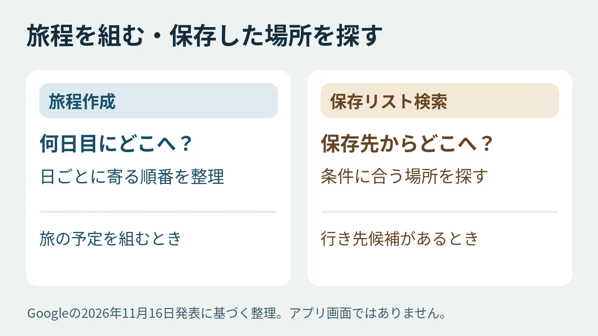

米Googleは11月16日、地図アプリの会話型機能「マップに相談（Ask Maps）」で、複数日にわたる旅行の日程を組み立てる機能と、自分が保存した場所をリストから探す機能を発表しました。どちらも「マップに相談」の提供地域が対象で、8月に提供開始が発表された日本も含まれます。AndroidとiPhone向けに順次展開するため、全員の画面に同時に現れるとは限りません。

## 行きたい場所の候補を、日ごとに並べる

今回の旅程作成では、立ち寄る順番を日ごとの予定にまとめ、地図上では立ち寄り先を番号付きで確認できるとGoogleは説明しています。店や観光地を一つずつ探すだけでなく、「この条件なら何日目にどこを回るか」を考えるための下書きです。

たとえば車で出かけるなら、「週末の2泊3日。1日目は海沿い、2日目は屋内で楽しめる場所。運転は短めで、3日目は昼過ぎまでに出発地へ戻りたい。日ごとに案を出して」と尋ねる使い方が考えられます。逆に、すでに候補を保存しているなら、「保存した場所のうち、滞在先の近くで雨の日にも寄れそうなところは？」と聞くほうが目的に合います。いずれも使い方の例で、出力や実機の動作を確認したものではありません。

*追加される二つの使い方を整理した図。実際のアプリ画面ではありません。*

## 今回、米国が先なのはどの機能？

今回発表された機能のうち、経路を表示したときに駐車場や充電設備、道路料金などのヒントをまとめて見せる機能と、近隣の店舗にオンラインや電話で空き枠を問い合わせる機能は、米国から先に提供されます。日本向けにも同時に追加されるわけではありません。これは今回の追加分の区別で、従来の交通情報が日本で利用できないという意味ではありません。

地図で旅程がまとまっても、店の営業や交通機関の運行、入場・予約の条件まで確定したわけではありません。まずは回る順番のたたき台に使い、実際に出かける前に、外せない立ち寄り先だけでも公式案内を確かめておくと安心です。
