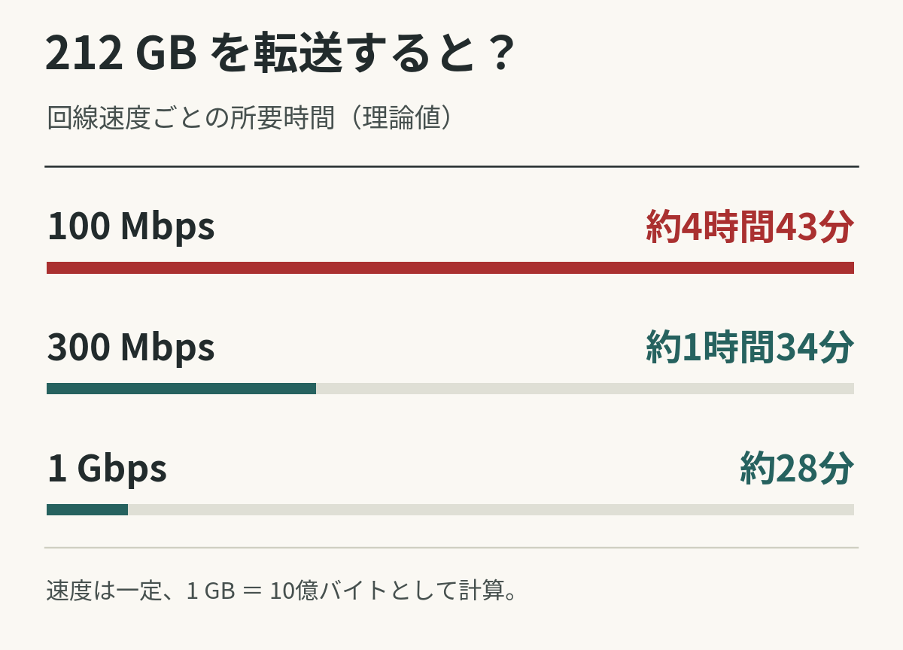

11月18日、米通信大手コムキャストのネットワークで過去最高の通信量を記録しました。『グランド・セフト・オートVI』（GTA VI）が発売されたのは、その翌日の19日。まだ遊べないゲームが、なぜ回線をにぎわせたのでしょう。

**「遊び始める時刻」と「データを受け取る時刻」が違うからです。** 予約した人は、11月10日からゲーム本体を先にダウンロードできました。発売時刻には、何時間も待たずに遊び始められる仕組みです。

## 最大212GB、家庭の回線で何時間分？

販売元のRockstar Gamesによれば、事前ダウンロードに必要な空き容量は機種によって最大212GB。仮に212GBを毎秒100メガビットで休みなく受け取ると、単純計算で**約4時間43分**です。実際の時間は、回線の混雑や機器の状態でも変わります。

この大きな荷物が、発売に向けて各家庭のゲーム機に届きました。コムキャストによると、11月18日の通信量のピークは平常日を31％上回り、翌19日は同社史上2位。発売当日はアメリカンフットボールの中継も重なっていました。

## 「最大24％」は、何に対する割合？

コムキャストが発表した24％は、発売前後のピーク時間帯に**同社の回線を流れた全データのうち、このゲームが占めた割合**です。英国でも記録が出ましたが、数字の意味は違います。

| 観測したネットワーク | 発表から読み取れること |
| --- | --- |
| 米国・コムキャスト | ピーク時にゲーム関連のデータが全通信量の最大24％を占めた。 |
| 英国・ヴァージン・メディアO2 | 18日午後8〜10時の通信量が、事前ダウンロードが始まった前週の最高記録を9.4％上回った。 |
| DE-CIXの世界各地の交換拠点 | 18日午後8時20分（中央ヨーロッパ時間）、全通信の合計が毎秒33.03テラビットに達した。 |

ゲームを起動した人数は、これらの数字からは分かりません。記録が捉えたのは、家庭のゲーム機にデータが届く時間にも、発売当日に匹敵する通信が集中したことでした。
