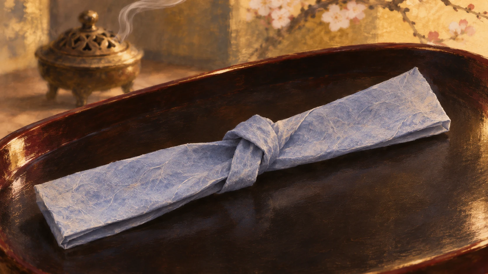
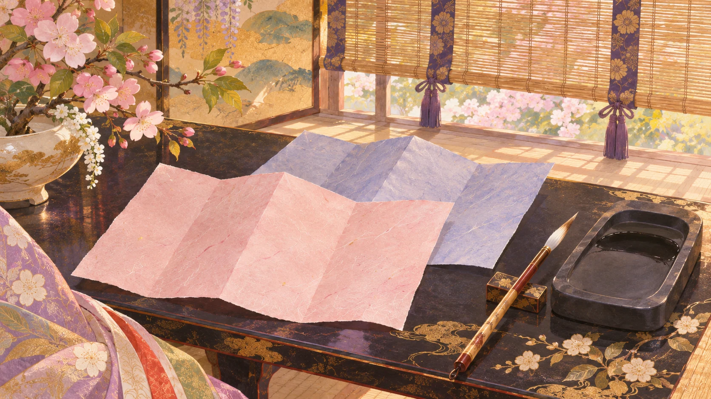

**『源氏物語』には、紙の香りまで描かれた恋文が登場します。**

紙の色や香りを想像するための参考イラストです。実際の手紙や道具を正確に復元したものではありません。

## 薄藍色の紙に、香りを添えて

聖徳大学短期大学部の古典入門は、『源氏物語』「胡蝶」の一場面を紹介しています。玉鬘に届いた求婚者たちの手紙の中に、柏木からの恋文があります。

大学の解説では、**香をたきしめた舶来の薄藍色の紙**に書かれた手紙と説明されています。掲載された原文にも「しみ深う匂へる」とあり、細く小さく結ばれた様子が描かれます。[聖徳大学の原文引用・解説](https://faculty.seitoku.ac.jp/arts-sciences/2014/01/27/99-%E7%B4%9B%E3%82%8B%E3%81%B9%E3%81%8D%E6%96%B9%E3%81%AA%E3%81%8F%E3%81%9D%E3%81%AE%E4%BA%BA%E3%81%AE%E6%89%8B%E3%81%AA%E3%82%8A%E3%81%91%E3%82%8A/)

## 文字だけではない、手紙の印象

この場面では、紙の色や香り、結び方に続いて、書きぶりや筆跡にも目が向けられます。受け取った手紙は、内容だけでなく、見た目や香りまで含めて細やかに描写されているのです。

もちろん、これは**文学作品の中の例**です。この一場面だけで、平安時代のすべての人が香る恋文を送ったとは言えません。動画の戦国風の物語とも、時代や登場人物は別です。

紙の香りまで想像させるところに、古典の描写の細やかさを感じます。手紙を読む場面も、文字だけを追うときとは少し違って見えてきます。
