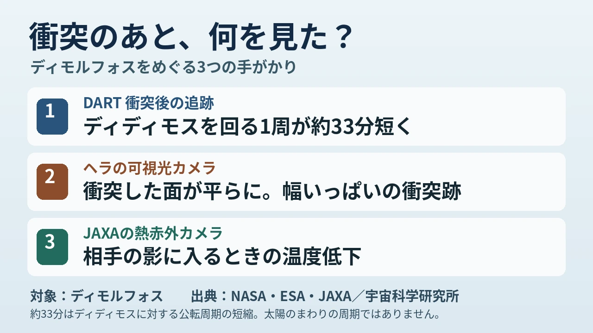

NASAの探査機DARTが2022年に衝突した小惑星ディモルフォス。その跡を、欧州宇宙機関（ESA）の探査機ヘラが近くから捉えました。ESAは現地11月25日、ドイツ・ベルリンで初の詳細画像を公開しました。日本では11月26日未明にあたります。ESAによると、衝突した面は平らになり、クレーターは小惑星の幅いっぱいに広がりました。反対に、ほかの領域には衝突前の画像と比べて大きな変化が見られない場所もあります。

## 「1周が約33分短くなった」だけでは、何が分からなかった？

ディモルフォスは、自分より大きい小惑星ディディモスの周りを回っています。DARTの衝突後、地上の望遠鏡でその1周の時間が約33分短くなったことが確認されました。これはディディモスの周りを回る時間の話で、地球や太陽の周りを回る周期の話ではありません。地上からは軌道の変化が分かっても、衝突跡の形までは見分けられませんでした。ヘラは近くから表面を撮り、複数の画像から、ディモルフォスの自転の向きが複雑に変わりながら公転していることも見いだしたとESAは説明しています。

*ディモルフォスを調べた3つの手がかり。出典：NASA、ESA、JAXA／宇宙科学研究所。*

## 日本のカメラは、影の中の変化を捉えた

衝突跡の説明に使われたのはヘラの可視光カメラ画像。一方、JAXAが開発した熱赤外カメラTIRIは、表面が出す赤外線を観測する。JAXAは、ディモルフォスが相手の影に入ったときに温度が下がる様子を、衝突跡の画像とは別に11月6日に報告しました。表面の温まり方や冷め方が分かれば、岩の塊が多いのか、細かな粒が多いのかを調べる手がかりになります。目に見える衝突跡と温度の変化を別のカメラで調べることで、同じように探査機を当てた場合に小惑星がどれだけ動くか、条件を理解する助けになります。今回の一例で、どの天体にも同じ方法が使えると分かったわけではありません。
