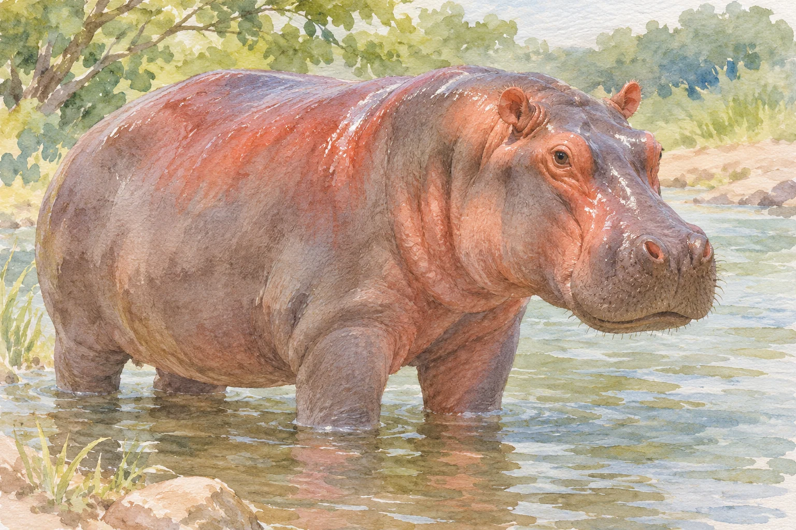
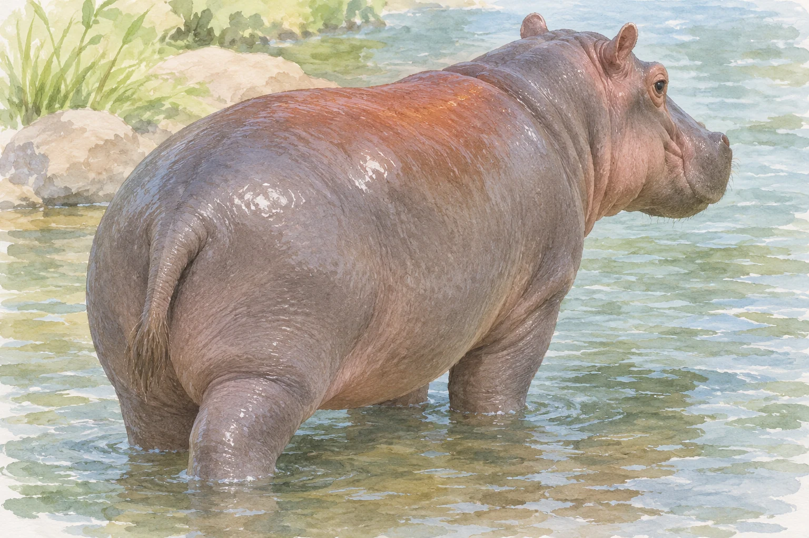

**カバの「赤い汗」と呼ばれるものは、血ではなく、皮膚から出る分泌液です。** 人間の汗と同じものでもありません。出た直後はほぼ無色ですが、その後に色が変わります。

AI生成の参考イラスト。赤みは血や傷ではなく分泌液のイメージです。実測色・薬効の図ではありません。

## 赤い色は、皮膚の上で生まれる

[福岡市動物園の説明](https://zoo.city.fukuoka.lg.jp/knowledges/detail/11)によると、この液体には少し粘りがあり、最初は透明に近く、しばらくすると赤くなります。

AI生成の参考・概念イラスト。分泌液による赤みの外観参考。血、傷、赤いクリーム、薬効、実測色の図ではない。

[橋本貴美子氏らの研究抄録](https://www.jstage.jst.go.jp/article/yukigoseikyokaishi1943/64/12/64_12_1251/_article/-char/ja/)によると、分泌液は出た直後は無色で、数分で赤くなり、数時間で茶色へ変わります。研究では赤色とオレンジ色の色素が取り出されました。

## 分泌液は皮膚を守る

[福岡市動物園の説明](https://zoo.city.fukuoka.lg.jp/knowledges/detail/11)では、この分泌液の膜が皮膚の乾燥や日焼け、細菌感染を防ぐとされています。赤く見えるのは血が出ているためではなく、分泌液の色が変わるためです。

## 血に見えるものが、皮膚を守る手掛かりに

遠くから見ると心配になる赤いぬれ方にも、体の仕組みが隠れています。見た目で血と決めつけず、分泌されたあとに何が起きているのかまで調べたことで、色と働きのつながりが見えてきたのです。
