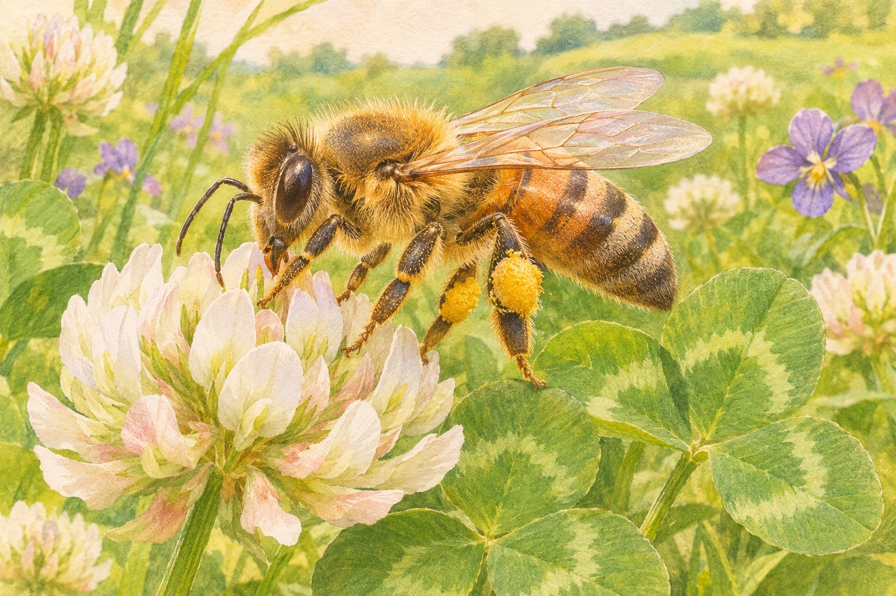
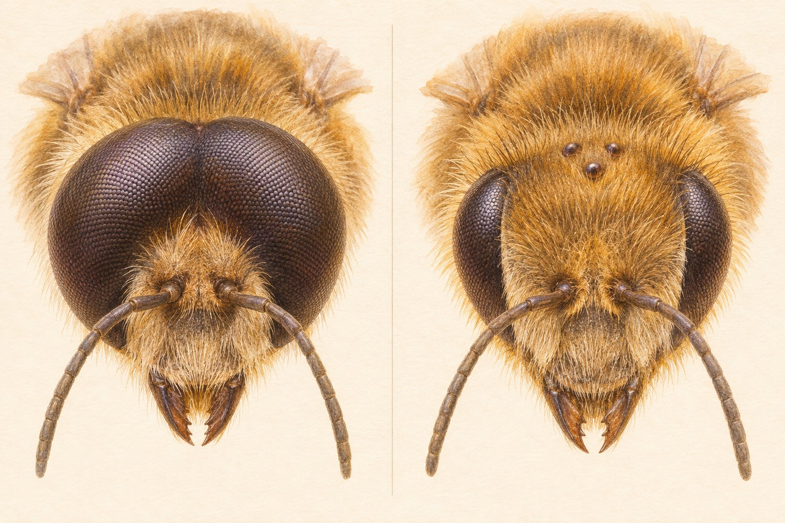

**ミツバチのオスには毒針がなく、刺すことができません。**でも、写真でオスとメスを見比べるなら、お尻の針を探すよりも「目」に注目すると違いがわかりやすくなります。

ここでは、養蜂で広く飼われるセイヨウミツバチ（*Apis mellifera*）を中心に紹介します。野外のハチに近づいたり、つかまえたりして確かめるための見分け方ではありません。

花を訪れる働き蜂のイメージ。本文中の画像はいずれもAI生成の説明用イラストで、実物を撮影した写真ではありません。

## 花で働くミツバチは、メス

ミツバチの巣には、女王蜂、働き蜂、雄蜂がいます。このうち、**女王蜂も働き蜂もメス**です。女王蜂が主に産卵を担い、働き蜂は幼虫の世話や巣の手入れ、蜜や花粉集めなどを担当します。雄蜂は「ドローン」とも呼ばれ、主な役割は女王蜂との交尾です。[フロリダ大学の解説](https://gardeningsolutions.ifas.ufl.edu/design/gardening-with-wildlife/beehive-social-structure/)

花粉を集めて巣へ運んでいるミツバチなら、それは働き蜂。名前だけでは性別がわかりにくいですが、花の上でせっせと動いている姿を思い浮かべると、身近なミツバチ像の多くはメスだったことになります。

## 写真で見比べるなら、まず大きな複眼

顔の両側にある大きな目は、小さな目の単位が集まった「複眼」です。セイヨウミツバチの雄はこの複眼がとても大きく、**左右の複眼が頭のてっぺんで接します。**働き蜂の複眼はそれより小さく、左右の間にはっきり隙間があります。[アリゾナ州立大学の解説](https://askabiologist.asu.edu/honey-bee-identification)

左が雄、右が雌の働き蜂。複眼の違いを説明するためのイメージで、毛や細部を含む正確な標本図ではありません。実物の比較は[大学の解説と掲載写真](https://askabiologist.asu.edu/honey-bee-identification)も参考になります。

雄の大きな目は、飛んでいる女王蜂を見つけることに役立ちます。単に顔つきが違うだけでなく、飛行中に相手を探す暮らしとつながっているのです。

体つきも補助的な手がかりになります。雄は働き蜂より大柄で、がっしり丸みのある印象。一方、女王蜂は長く伸びた腹部が特徴です。つまり「大きいから雄」とは決められません。写真の角度や個体差もあるので、体の大きさだけでなく目のつき方も合わせて見ます。[Purdue大学の解説](https://ag.purdue.edu/department/extension/ppp/resources/ppp-publications/mobile/ppp-116-pol-91.html)

## オスに針がないのは、針の成り立ちに理由がある

ハチの毒針は、進化の過程でメスの「産卵管」が変化した器官です。雄にはその産卵管がないため、毒針もありません。今ある毒針で卵を産む、という意味ではなく、もとの器官に共通の由来があるということです。[Purdue大学の針の解説](https://extension.entm.purdue.edu/publichealth/insects/stinging.html)

働き蜂はメスなので針を持ちます。そして、女王蜂にも針があります。「働き蜂は刺すけれど、女王蜂には針がない」というわけではありません。[Purdue大学のミツバチ解説](https://ag.purdue.edu/department/extension/ppp/resources/ppp-publications/mobile/ppp-116-pol-91.html)

## 「針が見えないからオス」とは言えない

メスの針は、いつも外へ突き出ているものではありません。写真に針が写っていなくても、それだけでは雄と判断できません。また、ハリナシバチの仲間のように、メスにも機能する針がないハチもいます。「雄には毒針がない」からといって、逆に「針がない個体は必ず雄」とは限らないのです。[ユタ州立大学の解説](https://extension.usu.edu/utah4h/research/creating-sustainable-school-and-home-gardens-misconceptions-about-bees)

今回の「大きな複眼が頭頂で接する」という目印も、すべてのハチに共通する判定法ではありません。種類がわからないハチに当てはめず、わからないときは距離を保ったままにしましょう。雄だと思って触ったり、確認のために巣へ近づいたりしないでください。

## 目の違いを知ると、写真の見え方も変わる

オスに針がないと聞くと、最初は「刺せないんだ」という意外さに目が向きます。でも、顔を比べてみると、あの大きな目にもちゃんと理由がある。蜜を集める働き蜂とは違う役割が、見た目にも表れているのが面白く感じます。

覚えておきたいのは、働き蜂はメスで、雄は目が大きいこと。そして、針が写っていないだけでは雄と決められないことです。次にミツバチの写真を見たら、お尻より先に顔が気になりそうです。