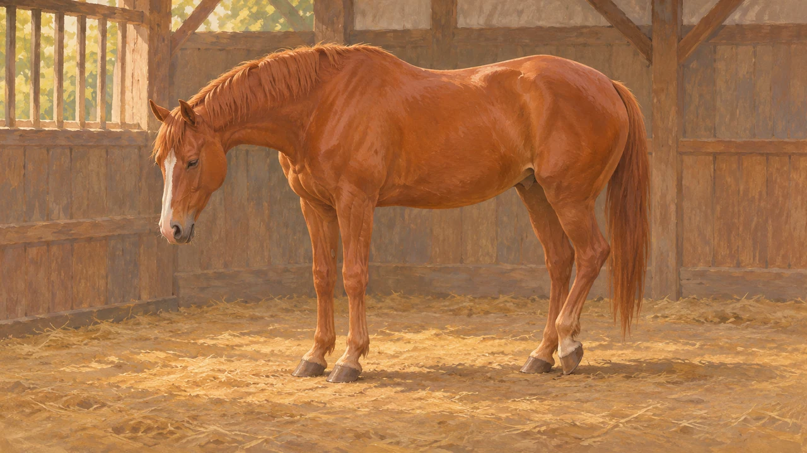
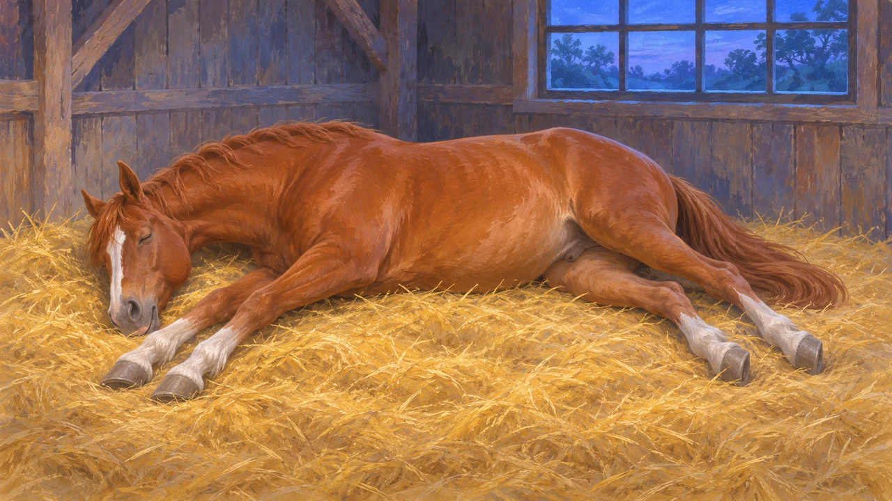

**馬は立ったまま眠れます。ただ、筋肉の緊張が大きく低下する典型的なレム睡眠は、体を地面に預けた馬で記録されています。** 「立ち寝ができる」と「すべての眠りを立ったまま済ませる」は、同じ意味ではありません。

立ったまま静かに目を閉じる馬を見ると、ずっとその姿勢で眠れるように思えますよね。でも、外から見える姿勢と、脳や筋肉の状態を分けて調べると、少し違う姿が見えてきます。

## 立っている間も、眠りは一種類ではない

AI生成の参考イラストです。この姿勢だけから、眠っているか、どの睡眠段階かを判定する図ではありません。

2008年の研究では、5頭の馬の脳波と行動を一晩にわたって記録し、立ったままレム睡眠と判定された例も報告しました。

ただし、立ったまま何事もなく眠り続けた、という話ではありません。1頭では、立った姿勢でレム睡眠と判定されたときに、体が部分的に崩れる場面が何度も記録されました。

この少数の記録を「立ったままで全部の睡眠が足りる」という証拠にはできません。一方で、「立位のレム睡眠は一度も観察されていない」と言い切るのも違います。

## レム睡眠は、横向きのときだけではない

AI生成の参考イラストです。実験に参加した馬の再現や、レム睡眠中だと確認した場面ではありません。

2026年の先行公開研究では、8頭について、それぞれ一つの睡眠周期を分析しました。この研究で、筋肉の緊張低下を伴う典型的なレム睡眠は、体を地面に預けた馬で見られました。胸を下にして鼻先を地面に預ける姿勢と、横向きに寝た姿勢の両方です。

立っている馬にも目が素早く動く状態はありましたが、姿勢を支える筋肉の緊張が残り、脳波も同じではありませんでした。研究者はこれを、レム睡眠に似た「REM-like」という状態として区別しています。

2008年と2026年では、記録した筋肉や睡眠段階の分け方などが異なります。新しい結果が古い記録をそのまま否定した、と読むことはできません。

立つ、伏せる、横になる。見た目ははっきり違っていても、それだけで眠りの中身まで分かるわけではない。馬の立ち寝が面白いのは、器用な姿勢だけでなく、その内側にいくつもの眠り方があるところです。
