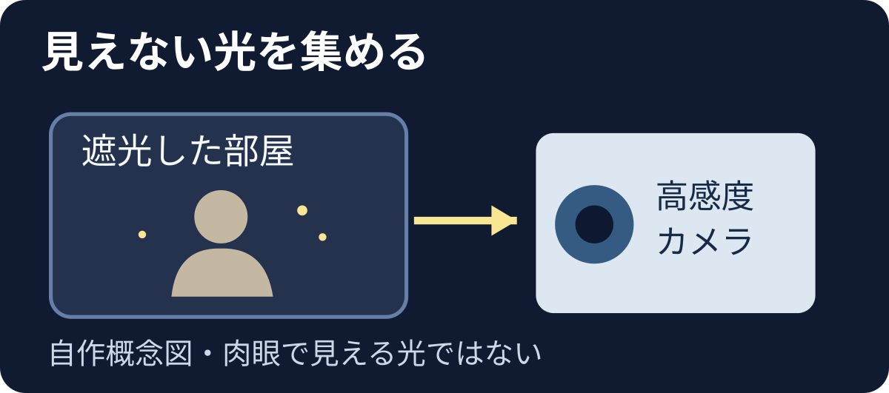
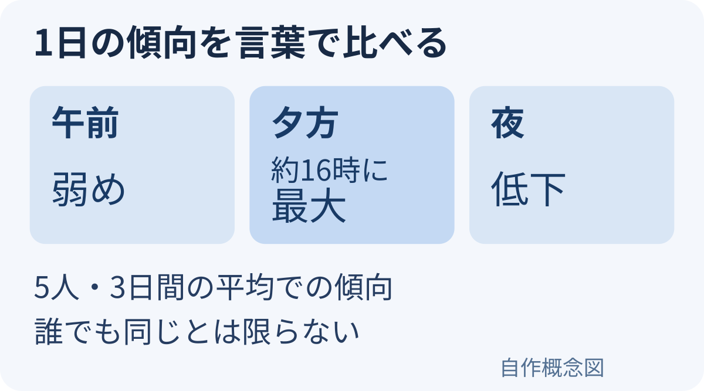

**人の体から、肉眼では見えないほど弱い光が出ることは、専用のカメラで確かめられています。** ここでいう「光る」は、暗闇で人がぼんやり輝いて見える、という意味ではありません。

## 光をどうやって見つけた？

[小林らの2009年の研究](https://doi.org/10.1371/journal.pone.0006256)では、健康な20代男性5人を対象に、外の光が入らない部屋で測定しました。入室後15分待ち、冷却した高感度CCDカメラで20分間撮影。10時から22時まで3時間おきに、3日間繰り返しています。長時間集めたわずかな光子を画像にしたのであり、普通のカメラや目でその場で見た光景ではありません。

## 1日の中で変わる？

この5人の測定では、発光は午前中に弱く、午後に増え、16時ごろに最大となりました。顔は上半身より強く、顔の中でも頬や口の周りと、目の周りとで差がありました。ただし、少人数かつ特定の生活・測定条件での観察です。「誰でも毎日16時に最も光る」とは言えません。

測定した10〜22時の範囲での傾向をまとめた図です。

## 体温の赤外線画像とは別の話

研究では体表面の温度も別に測り、微弱光の分布は温度画像と一致しませんでした。[赤外線カメラの画像](https://support.flir.com/docdownload/assets/web/27eh/en-us/T505000.xml.html)は物体が出す赤外線を捉え、温度を色に置き換えて見せます。今回の微弱光の画像と、同じ「光る写真」ではありません。

研究者は、体内の代謝に伴う化学反応で生じた励起分子などが光を出す可能性を論じています。ただし、この測定だけで日内変化の仕組みが確定したわけではありません。ましてや、オーラが見えることを示した研究でもありません。面白いのは、普段は見えないほど小さな現象を、測定技術で画像にできた点です。
