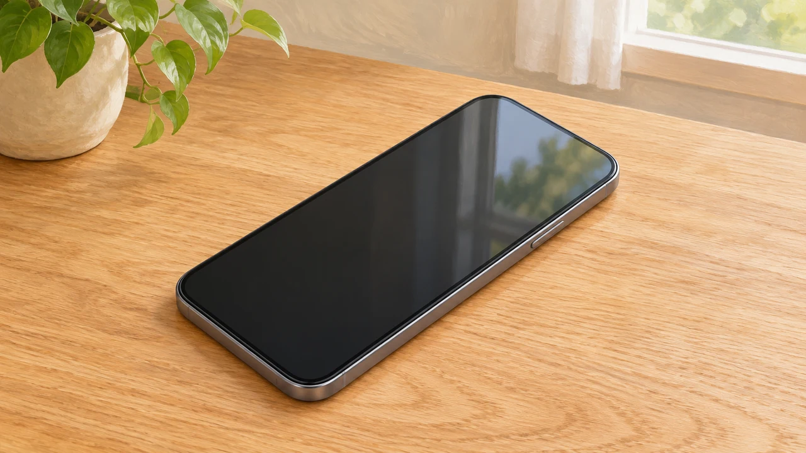
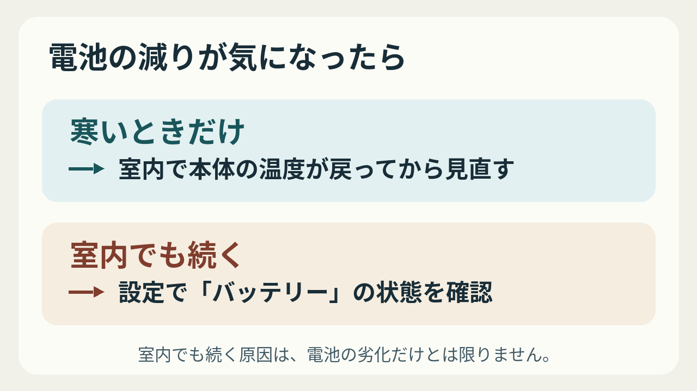

寒い外でだけiPhoneの電池が急に減るなら、まず室内へ移し、本体が自然に通常の温度へ戻るのを待ってみてください。寒さが原因で一時的に短くなった電池の持ちは、温度が戻れば元に戻ります。使った電気が復活するわけではなく、残量の表示が何％戻るかも決まっていません。

## 残量があるのに、なぜ電源が切れる？

電池にどれだけ電気が残っているかと、必要なときに十分な電力を出せるかは、別の話です。冷えた電池は電気を取り出しにくく、iPhoneが電力を使うと電圧が普段より大きく下がることがあります。動作に必要な電圧を保てないと、残量が表示されていても、本体が部品を守るために電源を切ることがあります。電池の残量が少ない場合や、電池が劣化している場合も、この影響が出やすくなります。

## 室内に戻ったら、電池の持ちを見直す

Appleが示すiPhoneの使用環境は、周囲の温度が**0〜35℃**です。0℃は使用環境の目安の下限で、どのiPhoneもその温度で電源が切れるという意味ではありません。本体が冷えすぎると、充電が一時的に保留になることもあります。温度が原因で「充電保留中」と出た場合は、通常の温度に戻ると充電が再開します。

室内でも電池の持ちが悪いなら、「設定」から「バッテリー」を開き、電池の状態も確かめてみましょう。項目名は機種やiOSのバージョンによって異なります。ここで見る「最大容量」は、新品のころと比べてどれだけ電気をためられるかを示す数字です。画面上の「残量」とは別で、経年劣化で減った容量は、室内に持ち帰っても元に戻りません。
