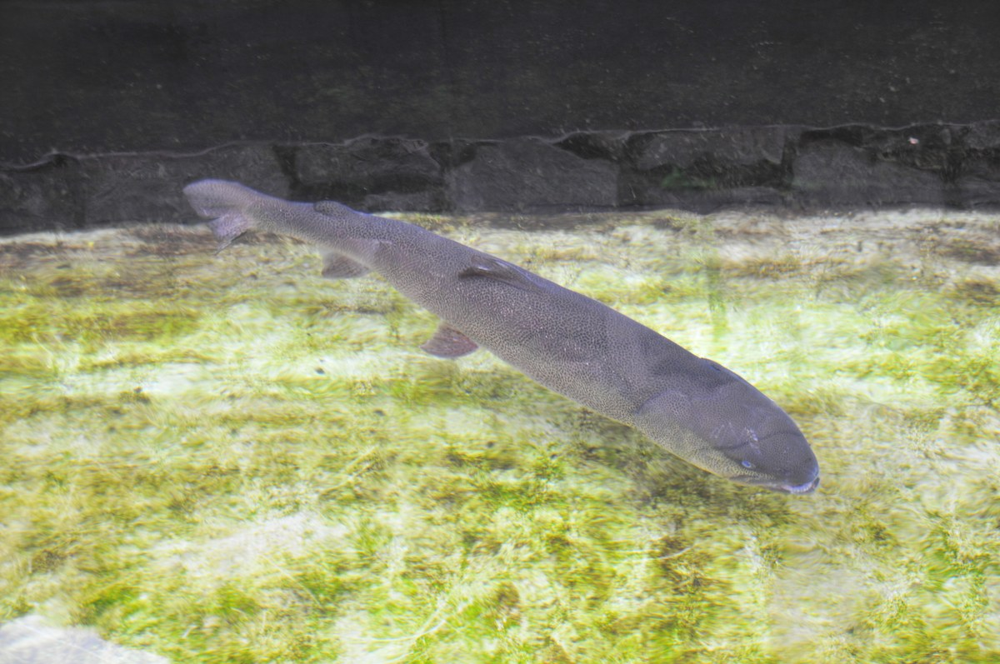
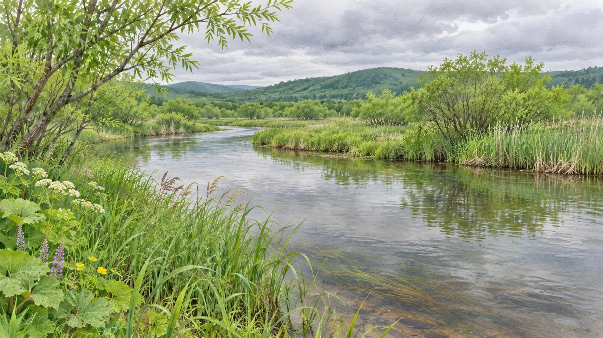
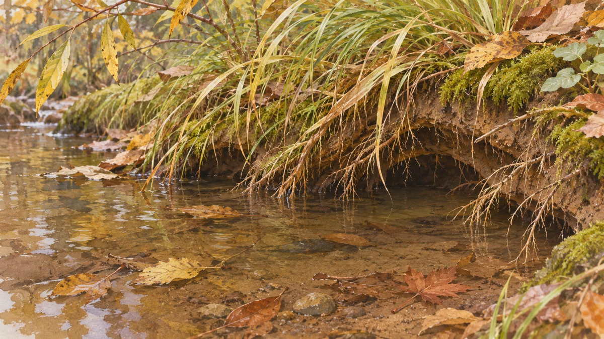

**イトウは実在する、サケの仲間の大型魚です。** 「幻」は伝説上の生き物という意味ではありません。[北海道の魚図鑑](https://www.pref.hokkaido.lg.jp/sr/gid/fis016.html)もこの通称を使い、生育環境の悪化で数を減らしてきた魚として紹介しています。

写真：ほくなん、2009年撮影／[Wikimedia Commons](https://commons.wikimedia.org/wiki/File:Hucho_perryi.JPG)、Public domain。飼育個体の参考写真です。掲載時は縮小・再圧縮のみ。

## 大きな魚が、小さな流れも使う

北海道の資料は、日本国内での自然分布を北海道とし、川や湿原の湖沼などを挙げています。本稿では、この国内の暮らしに目を向けます。

[道総研が公開する1997年の研究紹介](https://www.hro.or.jp/fisheries/publication/ima/o7u1kr000000546i.html)では、大型のイトウは川の下流域や湿原の湖沼を主に利用し、産卵には一般に上流域や小さな支流へ移動すると説明しています。大きな魚だから、広い水面だけあれば暮らせるわけではないのです。

大きな川や湿原の環境イメージ。特定の生息地を描いたものではありません。

## 稚魚には、目立たない場所も大切

同じ研究紹介では、秋から冬の稚魚が、本流の脇にある流れの緩い小支流を利用する様子も報告されています。岸から伸びる草木の根の下などに隠れていたそうです。これは紹介された観察の範囲であり、北海道の全河川の現状を一度に示すものではありません。

小さな流れと岸辺の根のイメージ。研究の観察地点や稚魚の個体数を再現したものではありません。

立派な魚を支えるのが、見落としそうな細い流れや岸辺の草木でもある。「幻」という大きな言葉の向こうに、そんな具体的な暮らしがあるのが印象的です。
