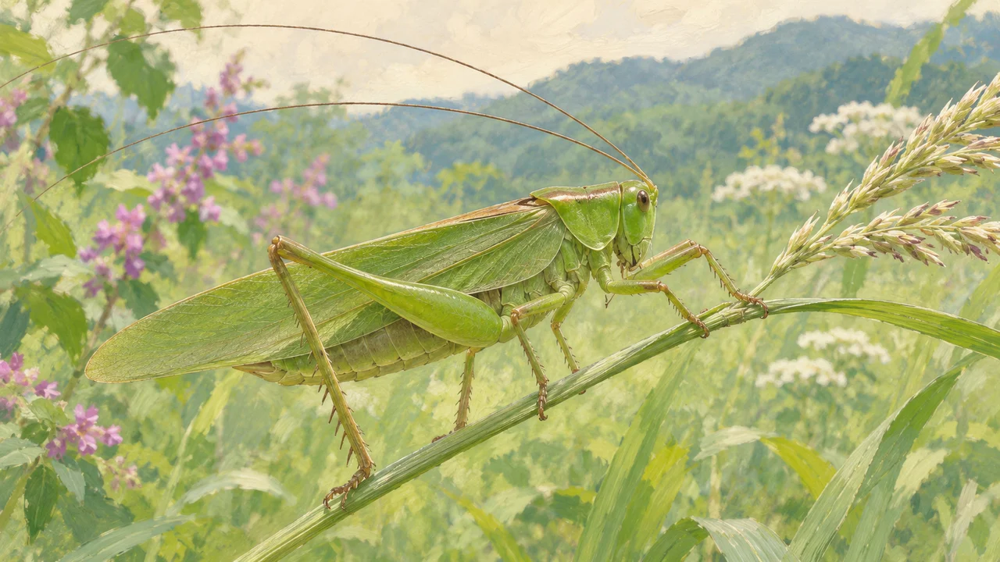
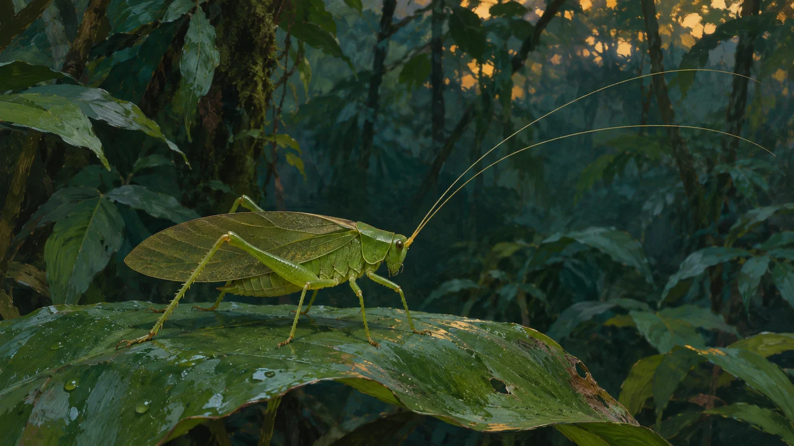

**キリギリスの耳にあたる「鼓膜器官」は、頭ではなく前脚のすねにあります。** 音で薄い膜が振動するしくみは、人の鼓膜と似ています。でも、耳の位置が違うだけではありません。体の中に、音のもう一つの通り道を持つ仲間もいるのです。

*草むらで暮らす姿の参考イラスト。耳の位置や内部構造を正確に示す解剖図ではありません。*

## 脚に耳があって、音の方向はわかる？

人は、左右の耳に音が届く時間や強さの違いを、方向を知る手がかりにします。ところが、体が小さい昆虫では耳どうしの間隔も小さく、そのままでは差をつかみにくくなります。

そこで面白いのが、南米のキリギリス科の一種、*Copiphora gorgonensis*を調べた研究です。この虫では、音が鼓膜の**外側と内側**に、別々の道を通って届きます。

## 音は、体の外と内から届く

外側への道は、空気を伝わって鼓膜に直接届く道。内側への道は、胸の開口部から入り、体内の管を通って鼓膜の裏側へ届く道です。

研究では、管を通る音は外側から来る音より遅く届き、特定の高さの音では鼓膜の振動が強まることが確かめられました。**同じ音でも、通る道が変わると、届き方が変わる**わけです。

この違いは、音の来る方向を見分ける手がかりになると考えられています。ただし、この研究で測った伝わり方と、野外での方向判別の詳しい性能は別の話です。「人のように二度聞こえる」といった主観的な聞こえ方まで確かめたわけではありません。

*熱帯林で暮らす仲間の雰囲気を描いた参考イラスト。研究対象の種そのものを再現した画像ではありません。*

## 人の耳と、働きが似ているところも

同じ南米の種を調べた別の研究では、人の耳との意外な共通点も見つかりました。空気中の音を受け取り、その振動を液体へ伝え、音の高さを分けて捉える働きです。

研究では、鼓膜まわりに小さなてこのように働く構造があり、内部の液体へ振動を伝えることが示されています。人の耳と同じ部品が入っているのではなく、**違う構造で、似た役割を果たしている**ところがポイントです。

ただし、ここで紹介した細かな測定は特定の種についてのもの。日本のキリギリスもすべて同じ性能だ、と広げて考えることはできません。

## 昆虫なら、みんな脚で聞くわけではない

コオロギも前脚に鼓膜器官を持ちますが、昆虫全体では、胸や腹に持つ仲間もいます。「昆虫の耳は脚」と丸ごと覚えると、かえって間違ってしまいます。

また、[チョウが足で味を感じるしくみ](/blog/butterfly-taste-feet/)は、同じ脚の話でも別の感覚です。場所だけでなく、何を受け取る器官なのかを見ると、虫の体がもっと面白くなります。

今回いちばん驚いたのは、耳が脚にあることより、体の中まで音の通り道に使っていたことでした。耳を頭に二つ置く人間の形が、唯一の正解ではない。小さな虫を見る目が少し変わる発見だと思います。
