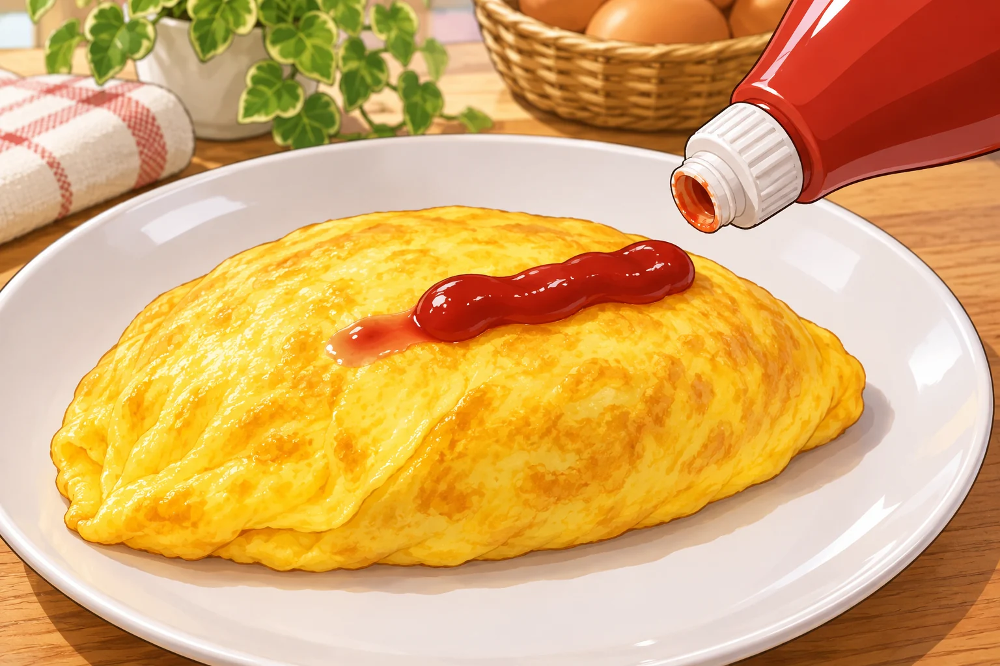
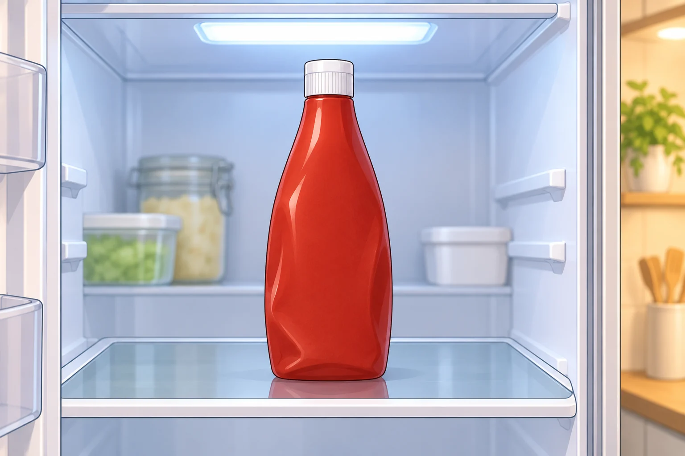

**ケチャップを出したときに先に出てくる水分は、ケチャップの液体部分が分かれ、注ぎ口にたまったものの場合があります。カゴメは、この分離自体は品質に問題ないと説明しています。**

オムライスに線を描こうとして、先に水分だけが出てしまう。そんなときの対処は、注ぎ口だけを見るのではなく、容器の中の状態を整えることです。

最初に水分が出るのは、液体部分の分離による場合があります。AI生成の参考イラスト。

## 出す前に、容器の中で混ぜる

ケチャップは、置いたままにしていると液体部分が分離することがあります。容器をもんだり揺り動かしたりして十分に混ぜると、元の状態に戻せます。

キャップはきちんと閉めてから、容器を扱いましょう。勢いよく振ることが目的ではなく、中身を混ぜることが目的です。

## 開封後は、キャップを上にして冷蔵庫へ

「残りを出しやすくしたい」と、容器を逆さに置きたくなることもあります。でもカゴメは、開封後に逆さで保管すると液体部分が漏れ出ることがあるため、キャップを上にした保存を勧めています。

また、保存時に容器の中の空気を抜くことも、分離を防ぐための案内に含まれています。

ここで紹介しているのはカゴメの案内です。容器や商品によって扱いが異なる場合があるので、手元の商品の表示があればそちらを優先してください。

カゴメは開封後、キャップを上にして冷蔵保存するよう案内しています。手元の商品の表示を優先してください。AI生成の参考イラスト。

## 開封後の保存期間も確認する

分離だけなら品質に問題がなくても、開封後の保存状態や経過日数は確認が必要です。

カゴメは、開封後は冷蔵保存し、おいしく食べる目安として1カ月程度で使い切ることを勧めています。これは「1カ月なら必ず安全」という保証でも、1日過ぎたら必ず傷むという線引きでもありません。ミニパックは開封当日中が目安で、通常の容器とは案内が異なります。

付着したケチャップをキャップから拭き取ることも、メーカーの案内の一つ。使い終わったら、注ぎ口まわりをきれいにして冷蔵庫へ戻したいですね。

使う前には中身を混ぜ、使い終わったら注ぎ口を拭き、キャップを上にして冷蔵する。カゴメの案内は、出すときだけでなく、冷蔵庫へ戻すまでを一続きの手入れとして教えてくれます。
