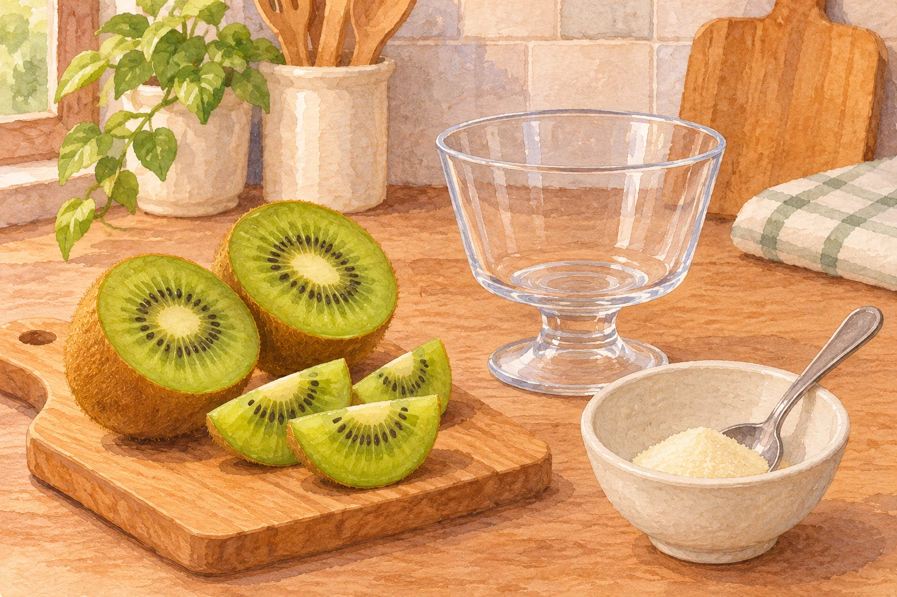
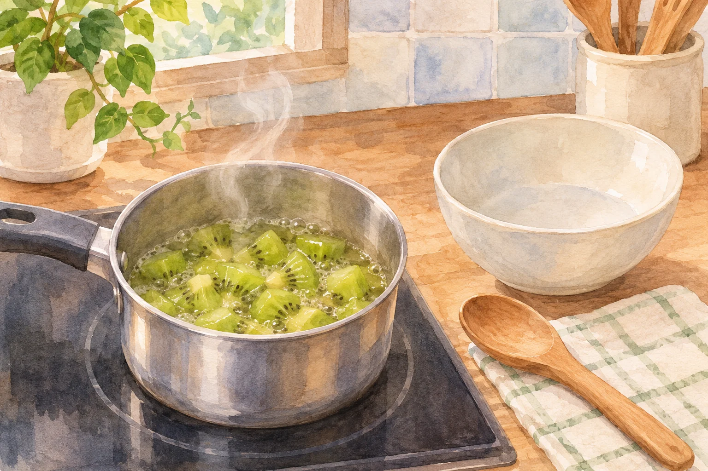

**生のキウイを入れたゼラチンゼリーは、固まりにくくなることがあります。** 原因の一つは、キウイに含まれる「アクチニジン」などのたんぱく質分解酵素。ゼラチンはたんぱく質なので、酵素の働きで分解されると、冷やしても思ったような固さになりません。キウイを混ぜた途端にゼラチンが一瞬で消えるわけではなく、材料の量や合わせ方、時間によって仕上がりは変わります。

キウイとゼラチンを使うデザートの材料を描いた参考イラスト（AI生成）。配合や完成状態を示すものではありません。

## ゼラチンとキウイで何が起きる？

森永製菓は、キウイやパイナップルに含まれるたんぱく質分解酵素が、ゼラチンのゼリー化を妨げると説明しています。果肉だけでなく、生の果実を絞った果汁でも同様です。果肉を細かくして全体に混ぜるなら、果汁もゼラチン液に触れることを忘れないようにしましょう。

ただし「キウイなら必ず固まらない」と言い切るのも正確ではありません。日本国内で入手した13品種を調べた研究では、ゼラチンを分解する働きに品種差が見られました。生の果肉を使ってもゼリーを作れた品種もあります。家庭で買ったキウイの品種や酵素の働きが分からないなら、生のまま入れると仕上がりが不安定になる、と考えるのが実用的です。

## 仕上がりを安定させるには？

仕上がりを安定させるには、キウイを先に十分加熱してから冷まし、ゼラチン液に加えることです。加熱で酵素の働きを抑えられます。森永製菓は煮沸した果実や加熱済みの缶詰を使う方法を紹介しています。「ちょっと温めれば必ず大丈夫」という一律の秒数はありません。果実の大きさや加熱方法で中までの温まり方が違うため、使う製品のレシピを参考にしましょう。

キウイを先に十分加熱し、冷ましてからゼラチン液に加える下準備の参考イラスト（AI生成）。加熱時間・温度・配合の指定ではなく、製品のレシピを確認してください。

生の食感を生かしたいなら、固まる材料を見直す手もあります。農林水産省によれば、寒天の原料はテングサなどの海藻。ゼラチンとは材料が異なるので、キウイのたんぱく質分解酵素をそのままゼラチンと同じ理由で心配する必要はありません。伊那食品工業も、薄切りにしたキウイを寒天液と重ねて冷やし固める「キウイの寒天ゼリー」を紹介しています。ただし寒天にも必要な煮溶かし方や配合があります。ゼラチンのレシピを単純に同量の寒天へ置き換えず、寒天製品の表示に従ってください。

もしゼリーが固まらなかったら、果物だけを犯人にしないことも大切です。ゼラチンが溶けきっていない、冷やす時間が短い、ゼラチンの量が少ないといった原因もあります。キウイを入れたかだけでなく、作り方を順に確かめると次の一回に役立ちます。

同じ果物でも、生か加熱済みかで結果が変わるのが面白いところ。キウイの色を楽しみたいデザートほど、先に固める材料と果物の扱い方を決めておきたいですね。
