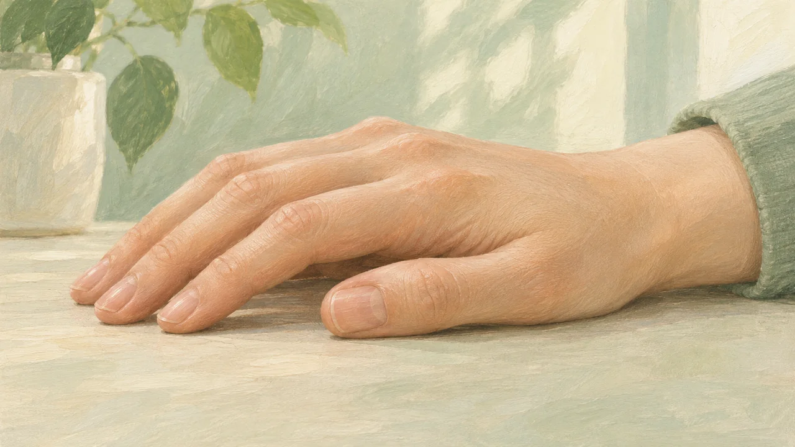
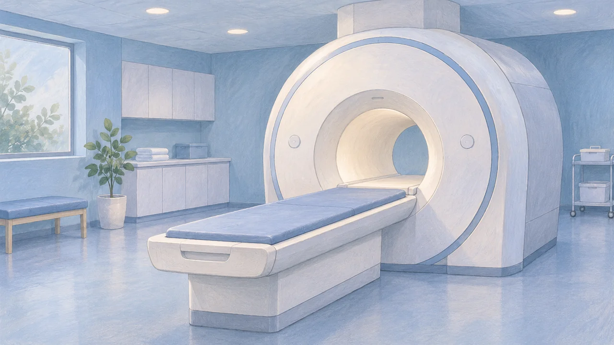

**指の関節が「ボキッ」と鳴る現象には、関節の中の液体にできる気泡が関係しています。** ただし、音が出るのは気泡ができるときなのか、それとも気泡が縮むときなのか。研究によって説明が分かれます。

*自然な手の形を描いたAI生成の参考イラストです。*

## MRIでは、音のあとにも空洞が見えた

*AI生成の参考イラストです。研究に使われた装置や撮影方法を再現したものではありません。*

2015年、Kawchukらは、1人の参加者の指の付け根にある10の関節をMRIで観察しました。音がしたとき、関節の間の液体に空洞が現れ、音がしたあとも見えていました。

この観察から、研究チームは、気泡がつぶれるときよりも、空洞ができるときに音が出ると考えました。ただし、MRIの映像にはコマとコマの間があります。ごく短い間に起きた変化まで、すべてが写っているわけではありません。

## 数式では、気泡が縮むときの音を説明できた

2018年の研究では、別の方法でこの音を調べました。関節の中で気泡が縮む動きを数式で表し、そこから出る音を計算したのです。

計算した音の大きさや主な周波数は、実際に測られた関節音と合っていました。この結果は、気泡が縮むことでも音を説明できる可能性を示しています。ただし、関節の中で気泡が縮む瞬間を映像でとらえたわけではありません。

面白いのは、どちらの研究も同じ音を調べているのに、見ているものが違うところです。MRIは音のあとに残った空洞を映し、数式は気泡が縮んだと仮定したときの音を再現しました。気泡が関係していることと、どの瞬間に音が生まれるかが分かったことは、別なのです。
