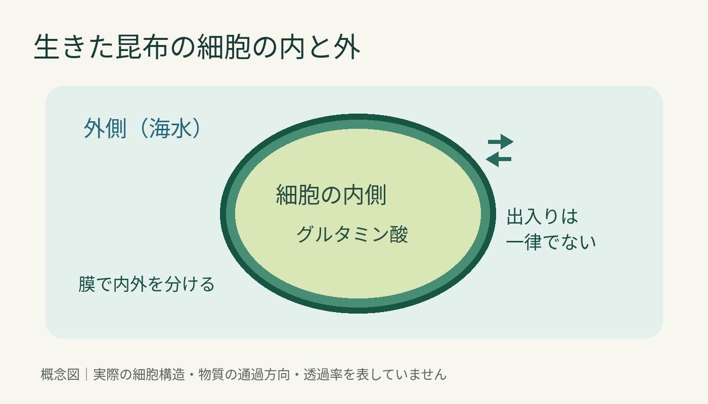
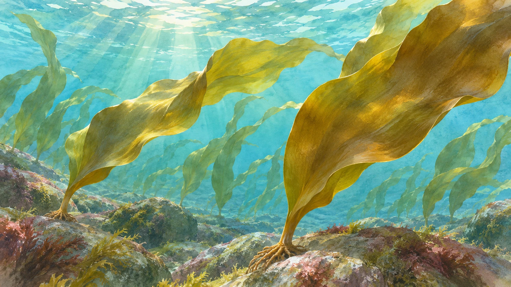

**海で育つ昆布のうま味は、生きた細胞の膜の働きによって、だしを取るときのようには外へ出ません。** [日本昆布協会のQ＆A](https://kombu.or.jp/qanda)は、細胞の内と外を分ける膜の「選択透過性」をその理由に挙げています。ただし、「海水にはうま味成分が一切ない」という意味ではありません。

独自の模式図。細胞の実際の形・数や物質の透過率を示す図ではありません。

## 生きた細胞は、ただの水入り袋ではない

昆布の細胞には、うま味に関わるグルタミン酸があります。水に浸かっているのだから、すぐ海へ溶け出しそうに思えます。けれども、生きた細胞には内側と外側を分ける膜があります。協会は、この膜の働きが、生育中の昆布からうま味成分が海中へ流れ出にくい理由だと説明しています。

ここで大切なのは、膜を「何も通さない壁」と考えないことです。選択透過性とは、物質の出入りが一様ではないということ。Q＆Aも、昆布が必要なものを取り入れ、不要なものを出す働きとして紹介しています。生きた昆布が、成分を何も外へ出さないという話ではありません。

海で育つ昆布の姿を伝える参考イラストです。特定の海域や種類、細胞の働きを再現したものではありません。

## だし用昆布では、比べる条件が違う

一方、台所で使うのは、採取・乾燥などを経ただし用昆布です。[日本昆布協会のだしの取り方](https://kombu.or.jp/power/dashi)でも、水に浸して成分を引き出しています。生育中の昆布とは、昆布の状態も、接する水や時間の条件も違います。

ここで確かめられるのは、だし用の昆布から水へ成分が移ることと、生育中の昆布には細胞の内外を分ける働きがあることです。どちらも水に触れていますが、同じ条件ではありません。

同じ「水の中」でも、比べる条件は別。昆布を食材として見るときと、生き物として見るときの違いが面白いですね。
