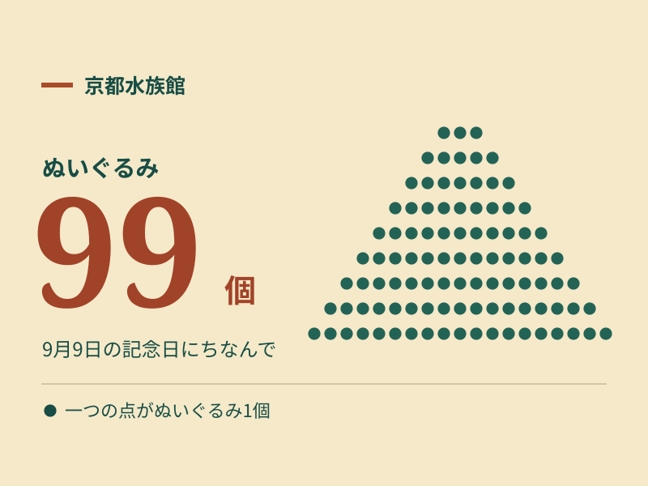

京都水族館の入口に現れたクリスマスツリーは、近くで見ると枝の先までオオサンショウウオ。11月21日（土）から展示している今年のツリーには、大小のぬいぐるみが**ぴったり99個**使われています。あと一つで100なのに、どうして99なのでしょう。

## 9月9日が、ちょうど9年目

オオサンショウウオは繁殖のため、9月ごろに活動が活発になります。その姿が数字の「9」にも似ていることから、京都水族館は9月9日を「オオサンショウウオの日」として申請し、2018年に記念日に認定されました。2026年は、そこから数えて9年目。この節目に合わせ、ぬいぐるみの数にも「9」を二つ並べたのです。

## てっぺんにある二つの魚は何？

ツリーはオオサンショウウオが勢いよく川を上っていく姿を表現したもの。いちばん上には、オオサンショウウオが**ウグイとニジマスの切り身**を持っているような飾りがあります。どちらも館で本当に与えているごはんです。

ほかにも、館の養蜂部で飼育しているミツバチの蜜ろうで作ったオーナメントが隠れています。2013年から続くこの冬の展示は、1階エントランスで見られます。終了時期は京都水族館の公式Xで案内されます。
