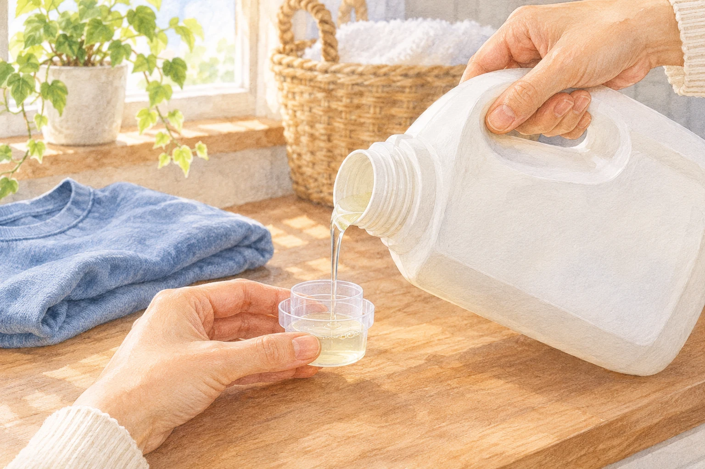
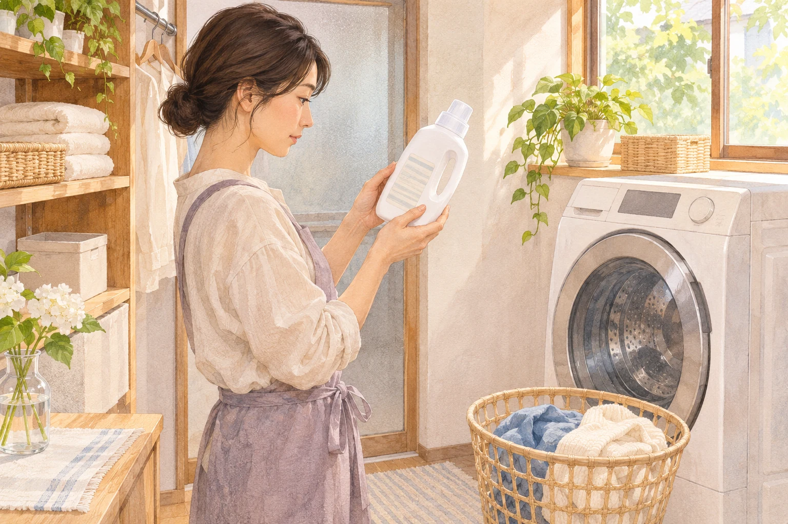

**洗濯洗剤を2倍入れても、汚れ落ちが2倍になるとはいえません。** 洗剤には力を発揮しやすい濃さがあり、適量を超えて増やしても、洗浄力はそれほど上がらないためです。まず基準にしたいのは、手元の製品に書かれた「使用量の目安」です。

汚れたシャツを見ると、いつもより多めに入れたくなるもの。でも、洗剤を足す前に、その目安が何を表しているかを見てみましょう。

## 使用量の目安には、理由がある

[日本石鹸洗剤工業会](https://jsda.org/w/03_shiki/osentakunokagaku_4.html)は、洗剤ごとに界面活性剤の種類や配合が違い、必要な使用量も異なると説明しています。容器に書かれた目安は、過不足なく洗浄作用が働く範囲を考えて設定されたものです。

ここでいう「濃さ」は、水に対して洗剤がどれくらい入っているか、という洗濯中の濃度のこと。同じ洗剤を同じ量入れても、水量が違えば濃さは変わります。一方、売り場で見かける濃縮タイプなどの違いは、もともとの製品の配合に関わる話です。どちらも「濃い」と表現できるので、少し紛らわしいですね。

別の洗剤に替えたとき、前の製品と同じキャップ一杯でよいとは限りません。容器の大きさや見た目ではなく、新しく使う製品の表示を読み直すのが確実です。

目分量で足すより、製品に合う目安を確かめて計量を。画像の液量は、実際の使用量を示すものではありません。

## 多すぎても、少なすぎても困る

適正な濃度の範囲を超えても、汚れを落とす働きが同じ調子で伸び続けるわけではありません。工業会の説明でも、使いすぎによる洗浄力の上積みは小さいとされています。洗剤の量を単純に倍にして、効果も倍になると考えることはできないのです。

さらに、[パナソニック](https://jpn.faq.panasonic.com/app/answers/detail/a_id/95)は、洗剤が多いと衣類に残りやすくなると案内しています。同社のドラム式洗濯機については、泡が多いと排水と給水を繰り返し、洗剤の濃度が下がって汚れ落ちが悪くなる場合も説明されています。この仕組みを、すべての洗濯機にそのまま当てはめることはできません。

では、思い切り減らせばよいのでしょうか。それも違います。洗剤が足りなければ汚れが十分に落ちず、落ちた汚れが衣類に付くのを防ぐ働きも不十分になることがあります。多すぎる場合と少なすぎる場合では、起こりうる問題が違うのですね。

## 水の量と、服の量は別に見る

洗濯機の画面に出る数字は、水量の場合もあれば、洗剤の杯数などの場合もあります。[ライオンの案内](https://qa.lion.co.jp/faq/show/184?site_domain=default)では、タテ型では水量や衣類量を製品の表示と照合し、ドラム式では洗濯機の洗剤量表示と衣類量の関係も取扱説明書で確かめるよう勧めています。

節水型の洗濯機では、水が少なくても衣類はたくさん入っていることがあります。水だけを見て自己判断で洗剤を減らすと、服の量に対して不足する場合があるためです。水量と衣類量のどちらを基準にするかも、使用する製品と洗濯機の案内を組み合わせて確認しましょう。

自動投入を使っている場合も、製品に合う基準量の設定が必要です。洗剤を替えたら、その設定も確認したいところです。

容器の使用量表示と、洗濯機の案内を一緒に確認します。絵の容器や操作部は特定の製品を再現したものではありません。

## すすぎの回数まで、製品の表示で

「すすぎ1回」と案内されている洗剤もあります。[ライオンのFAQ](https://qa.lion.co.jp/faq/show/723?site_domain=default)では、その対象となる製品名を挙げて説明しています。つまり、液体洗剤なら何でも同じ回数でよい、という意味ではありません。

洗剤の量と同じく、すすぎも使う製品や洗濯機、コースの指示に合わせます。多めに入れた分を、決まった回数の追加すすぎで必ず解決できる、と一律に考えるのは避けたいところです。

汚れが残るときは、洗剤の量だけでなく、衣類の詰め込みや選んだコースにも確認の余地があります。パナソニックも、洗える量は機種やコースで異なると説明しています。洗剤をもう一杯足す前に、容器の裏と洗濯機の表示を見比べる。そのひと手間が、いつもの洗濯を見直す入口になります。
