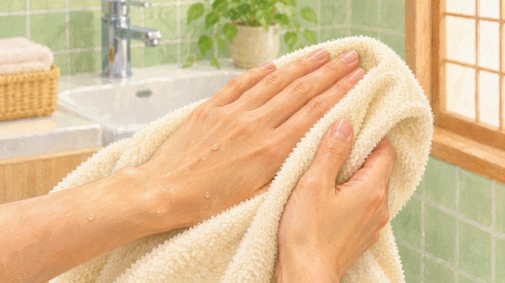
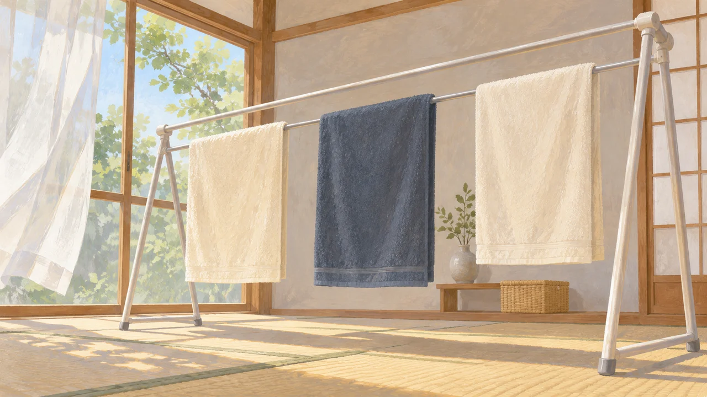

**乾いてにおわなくなっても、においのもとまで消えたとは限りません。** 布が再び湿ると、残っていたにおいを感じやすくなることがあります。乾いたタオルで手を拭いたときに、嫌なにおいが戻る理由の一つです。

「ちゃんと乾かしたのに」と思うところですが、乾くことと、においのもとを取り除くことは別。この違いを知ると、洗濯の見直し方も少し変わります。

## 湿ることで、においが戻る

ライオンの研究者が[日本家政学会で報告した研究](https://www.jstage.jst.go.jp/article/kasei/63/0/63_0_55/_article/-char/ja)では、実際の家庭から集めた、においのある衣類を調べています。部屋干しの際に悪臭を発していた衣類を湿らせると、においが再び感じられました。においの強さには、水分だけでなく温度も影響していました。

同社の[研究紹介](https://www.lion.co.jp/ja/rd/development/home/case01.php)では、布が湿ると、空気中へ出るにおい成分の量が増えたと説明されています。乾いた状態で気にならなかったことは、においの成分がなくなった証拠にはならないのです。

ただし、これは特定のにおいのある衣類についての結果です。タオルのにおいをすべて同じ原因で説明できるわけではありません。

## 「においができる」と「また感じる」は別

洗い終えた布を長く湿ったままにすると、残った菌が増え、においが発生しやすくなります。一方、乾いた布が濡れてにおいを感じることを、「その瞬間に菌が一気に増えた」と説明するのは早計です。すでにあった成分が感じやすくなる場合もあるからです。

[洗濯物の菌を調べた原著論文](https://journals.asm.org/doi/10.1128/aem.07816-11)では、生乾き臭の一成分を作るモラクセラという仲間の菌が見つかっています。洗って乾かした布にも菌が残っていたという結果は、「乾燥すればすべてリセットされる」わけではないことも教えてくれます。ただし、あらゆる生活臭の原因がこの菌一つ、という研究ではありません。

## 洗うところと、乾かすところを分けて見直す

[花王の案内](https://www.kao.com/jp/qa/detail/15871/)では、汚れをきちんと落とすことと、乾燥を早めることが、におい予防のポイントに挙げられています。干すときは布同士の間隔をあけ、必要に応じて除湿や換気を使います。湿った雑巾も丸めたままにせず、広げて干す、と考えると分かりやすいですね。

すでににおう布については、干し直すだけで解決したと決めつけず、洗い方も見直したいところです。衣類や製品の表示に従い、洗濯物を詰め込みすぎていないか、洗剤量が合っているかを確認しましょう。多く入れればよいわけではない点は、[洗濯洗剤の量についての記事](/blog/laundry-detergent-dose/)でも紹介しています。

意外なのは、同じ布でも、乾いているときと使うときで印象が変わることです。「乾いているから大丈夫」だけでは見落とすものがある。においを作らせない干し方と、もとになる汚れを残しにくい洗い方を、別々に考えるのが大切なのですね。
