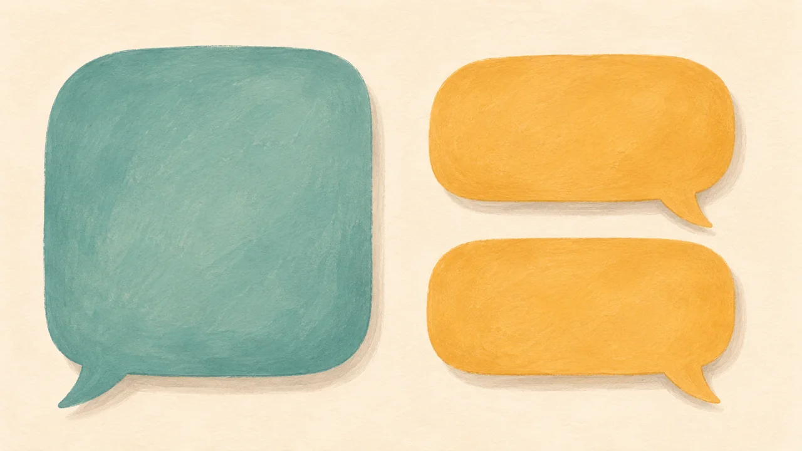

「了解」と「了解。」。最後に丸が一つあるだけで、同じ返事がよそよそしく見えることがあります。ところが、大学生が架空のチャットを読んだ実験では、文末に句点がある場合、冷たさと礼儀正しさの両方が少し高く評価されました。

## 吹き出しの途中と、最後の「。」

*一つの吹き出しに二つの文を書く場合（左）と、二つに分けて送る場合（右）を描いたAI生成の概念図です。実際のアプリ画面や会話履歴ではありません。*

「今着いた。改札の外で待ってる」と一つの吹き出しに入れると、途中の句点が「着いた報告」と「待ち合わせ場所」を分けてくれます。一方、「今着いた」「改札の外で待ってる」と二つに分けて送れば、吹き出しの切れ目がその役を果たします。

加納なおみさんらは、2016 年に大学生 10 人から集めた、友人との実際の LINE の履歴を分析しました。句点は全体では少なめでしたが、使い方はやりとりによって違います。たとえば進路の相談では、一度にいくつもの文を送る場面で句点をよく使う人がいました。「！」や絵文字で文を締める会話もあります。研究者は、送信ごとに区切りが見えることが、句点を省ける理由の一つだと考えています。

## 「丁寧」と「冷たい」は別々の印象

*待ち合わせの例を描いたAI生成の参考イラストです。研究で使った刺激画像ではありません。*

日山陽菜さんらの実験では、一つの大学の学生に架空のチャット画面を見せ、句点の有無で印象を比べました。「礼儀正しさ」と「冷たさ」は別々に尋ねた項目です。一方、この実験では、「怖い」「威圧的」の評価について、句点の有無による明確な違いは見つかりませんでした。友人との会話とアルバイト先の連絡で、句点の影響が違うとまでは確認されていません。

面白いのは、丁寧に見えることと、温かく見えることは別だというところ。次に「了解。」が気になったら、丸だけではなく、その前のやりとりや相手のいつもの書き方も思い出してみると、違う読み方ができるかもしれません。

