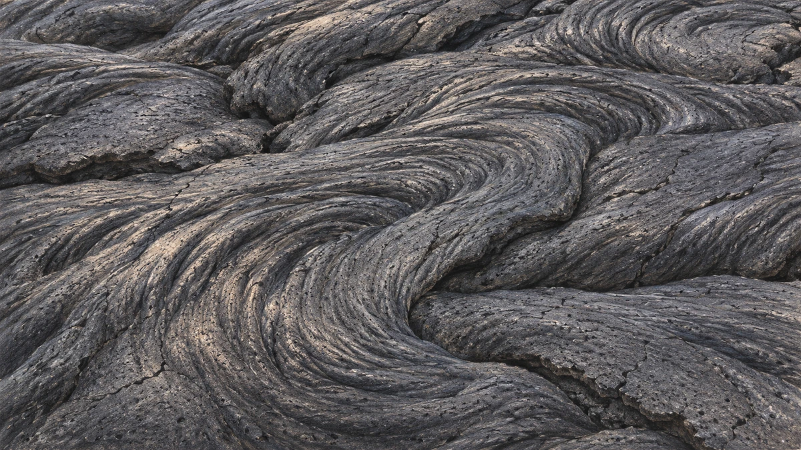
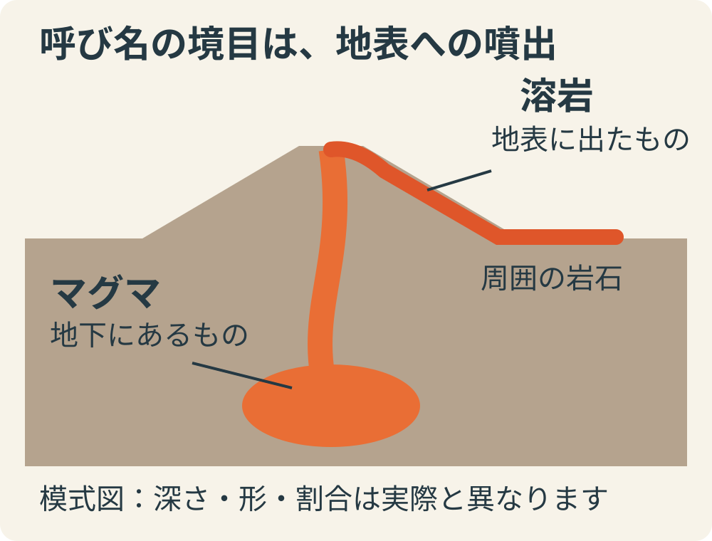
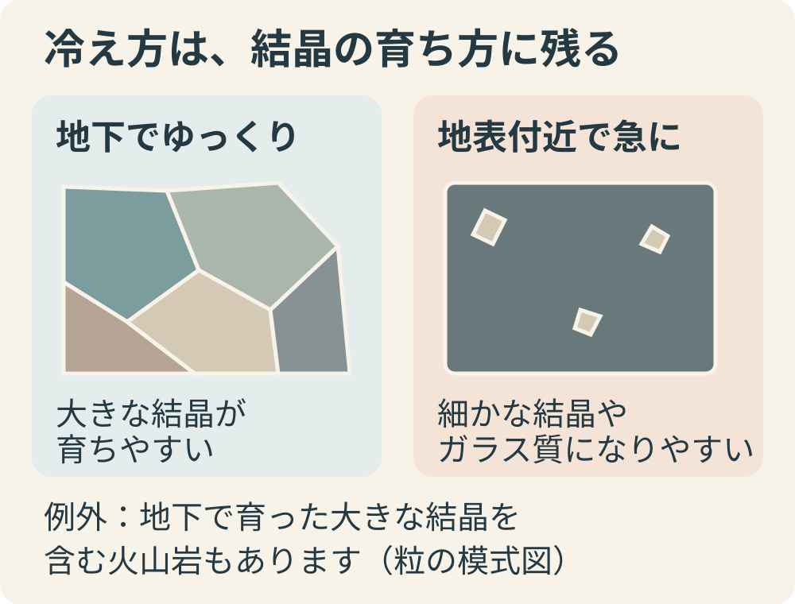

**地下にある溶けた岩石を「マグマ」、それが地表へ噴出したものを「溶岩」と呼びます。** 呼び分けの基本は、温度の高さや赤さではなく、地下にあるか、地表へ出たかです。[米国地質調査所（USGS）の用語解説](https://www.usgs.gov/faqs/what-difference-between-magma-and-lava)

冷えて固まったパホイホイ溶岩をイメージしたAI参考画です。[玄武岩質溶岩に見られる表面の形の一例](https://www.nps.gov/articles/000/lava-flow-forms.htm)で、すべての溶岩がこの姿になるわけではありません。

呼び名の境目を示した独自の模式図です。火山内部の形、深さ、マグマの量を正確に表した図ではありません。

## 地表に出たら、何でも「溶岩」？

マグマが地表に出るとき、いつも赤い川のように流れるとは限りません。流れ出す場合もあれば、細かな岩石の破片が、ガスとともに噴き出す場合もあります。火山灰などの破片には、それぞれ別の呼び名があります。「火山から出てきたものを全部まとめて溶岩」と覚えると、少し大ざっぱすぎるのです。[USGS「How do volcanoes erupt?」](https://www.usgs.gov/programs/VHP/about-volcanoes)

「地下ではマグマ、噴出すると溶岩」という短い説明は、溶けた岩石の呼び分けをつかむ入口。噴出物の種類まで考えると、もう少し細かい区別があるとわかります。

## マグマは、液体だけではない

溶けた岩石と聞くと、中身が均一な液体を思い浮かべがちです。けれど、マグマにはすでにできた鉱物の結晶や、溶け込んだガスも含まれます。液体の中に固体が混じっていても、マグマなのです。[USGSのマグマの説明](https://www.usgs.gov/programs/VHP/about-volcanoes)

この「地下にいるうちから結晶がある」という点は、冷えて岩石になった後の姿を考えるときにも大切です。岩石に見える粒の一部は、地表に出るより前から育っていた可能性があります。[米国国立公園局の火山岩の解説](https://www.nps.gov/subjects/geology/igneous.htm)

## 冷え方の違いが、岩石の粒に残る

マグマや溶岩が冷えて固まってできる岩石は、「火成岩」と呼ばれます。地下でゆっくり冷える深成岩では、結晶が大きく育ちやすくなります。一方、噴出して急に冷える火山岩では、細かな結晶やガラス質の部分ができやすくなります。[米国国立公園局「Introduction」「Intrusive／Extrusive Rocks」](https://www.nps.gov/subjects/geology/igneous.htm)

冷え方と粒の育ち方の関係を示す独自の模式図。色や粒の数は説明用で、特定の岩石標本を描いたものではありません。

ただし、**「火山岩なら大きな結晶はない」とは言えません。** 地下で先に育った結晶を含んだまま噴出し、その周りが急に冷え固まることもあるからです。こうした大きな結晶を「斑晶（はんしょう）」、周りの細かい部分を「石基（せっき）」と呼びます。[米国国立公園局「Parts of Rocks」](https://www.nps.gov/subjects/geology/igneous.htm)

小さな粒と大きな粒が一つの岩石に同居していたら、単に冷える速さが一通りだったとは限りません。岩石の見た目には、地表に出る前と後の両方が残ることがあるのです。

## 名前の違いから、岩石の来た道へ

マグマと溶岩は別々の物質の名前だと思いやすいですが、まず注目したいのは、どこにあるかという違いでした。さらに冷えた後の粒まで見ると、地下で過ごした時間にも話がつながります。

短い呼び名の違いから、石のでき方まで見えてくるのが面白いところです。火山の映像や岩石の写真を見るとき、赤い流れだけでなく、その先に残る石にも目を向けたくなります。
