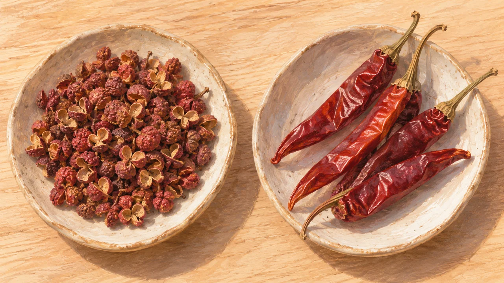

麻辣湯の「麻」は花椒のしびれ、「辣」は唐辛子の辛さ。唇のピリピリは細かな振動に似ていて、口のヒリヒリは熱さに似ています。同じ一杯でも、辛さの強弱だけでは説明できない二つの感覚です。

## 花椒のピリピリを、指先の振動と比べる

花椒のしびれに関わる成分の一つが、ヒドロキシαサンショオールです。研究者は、花椒で唇に生じるピリピリを、指先に与えた振動と比べました。

*唇の刺激と指先の振動を比べる考え方の模式図。実験装置や手順の再現ではありません。*

8人が比べた結果、唇の感覚に似ていると選ばれた指先の振動は、平均で約50ヘルツ。1秒に約50回です。測ったのは「どの速さの振動に似て感じるか」で、唇が物理的に震えた回数ではありません。

一方、唐辛子のカプサイシンは、強い熱にも反応する神経のセンサーを刺激します。唐辛子で焼けるような感覚がするのは、料理が熱いからだけではないんです。

## 牛乳の実験で測ったのは「ヒリヒリ」

辛いトマトジュースを使った実験では、普通の牛乳と脱脂乳は、口のヒリヒリの評価が大きく下がった飲み物に含まれました。牛乳に含まれるタンパク質だけで比べると、カゼインを含む液で水よりヒリヒリが弱まった実験もあれば、別の条件ではカゼインや乳清タンパク質の液と水にはっきりした差が出なかった実験もあります。牛乳のどの成分が、どの条件でどれだけ関わるかは、これだけでは決まりません。

いずれも測ったのは唐辛子の成分によるヒリヒリで、花椒のしびれに同じことが起きるかは分かりません。「辛い」のひと言で済ませていた一杯も、ピリピリとヒリヒリを分けて考えると、ちょっと違って見えてきます。
