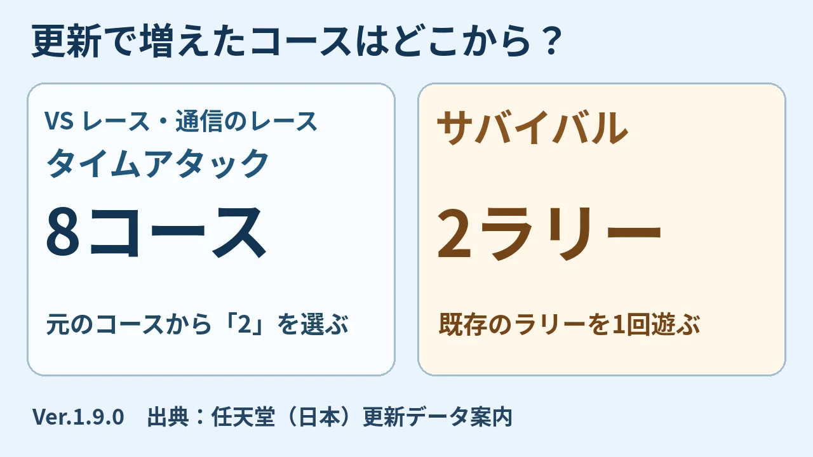

任天堂は米国サイトで11月24日付、日本のサポートで25日付で、Nintendo Switch 2用『マリオカート ワールド』の更新データ Ver.1.9.0 を案内しました。**組み替えた8コースは元のコースから、2つの新ラリーは「サバイバル」から**選びます。追加の10本が一つのメニューに並ぶわけではありません。

## 8コースは、元のコースを選ぶ画面から

任天堂の日本向け案内によると、「VS レース」「タイムアタック」や通信対戦の「レース」が対象です。例えば、「DKスノーマウンテン」を選ぶ場所から「DKスノーマウンテン 2」を選べます。まず一人で道を覚えたいなら、タイムアタックから探すと分かりやすいです。

ほかの7つは、キラーシップ、サンサンさばく、ソルティータウン、ノコノコビーチ、ヘイホーカーニバル、マリオブラザーズサーキット、ワリオスタジアム。それぞれに「2」が加わります。米国の任天堂は、通常とは別の道を走る例や、逆回りになる例を挙げています。全部が逆回りという意味ではありません。

*Ver.1.9.0で増えたコースとラリーの選び方。ゲーム画面ではありません。出典：任天堂の日本向け更新データ案内。*

## 2ラリーは、サバイバルを遊んでから

ハネラリーとまねきネコラリーを選ぶ場所は「サバイバル」です。日本向けの案内では、サバイバルでいずれかのラリーを一度でも遊んだことがあれば選べます。優勝が条件とは書かれていません。

## ローカル通信も、友達と更新版をそろえる

Ver.1.9.0 に更新すると、旧版の本体とはローカル通信やLANプレイができないと任天堂は案内しています。オンライン要素にも最新の更新データが必要です。同じ場所で遊ぶ予定でも、集合前に使う版をそろえておくと迷いません。
