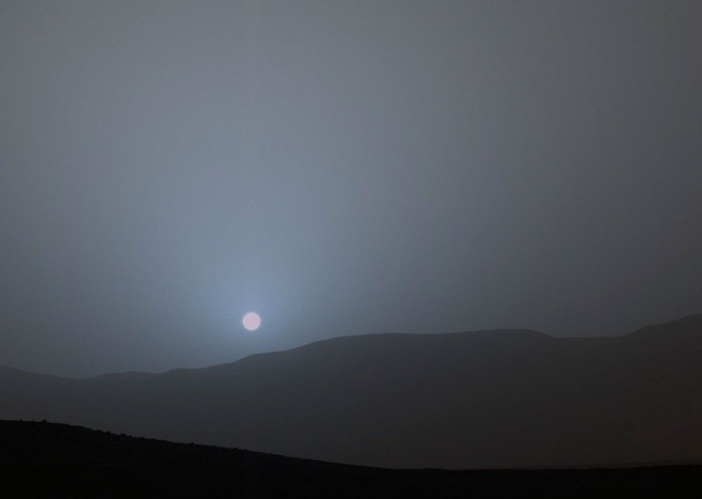
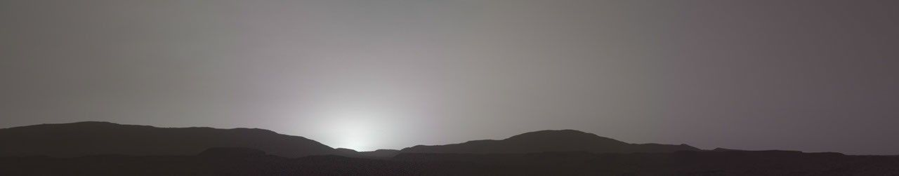

**火星では夕方、太陽の周りが青っぽく見えることがあります。大気中の細かなちりが光を散乱させ、青い光が太陽に近い方向で目立つためです。空全体が青くなるわけでも、毎回同じ青さになるわけでもありません。**

赤い惑星に青い夕日。言葉だけでも写真を見たくなる組み合わせです。地面の色と夕方の空の色は、別の条件で決まっています。

## 探査機が届けた青みのある夕日

2015年4月15日、キュリオシティが火星のゲール・クレーターで撮影した日没。色は較正・ホワイトバランス調整済み。画像：NASA/JPL-Caltech/MSSS/Texas A&M Univ. [画像の出典](https://science.nasa.gov/resource/sunset-at-mars-gale-crater-curiosity/)

NASAの探査車キュリオシティは2015年4月15日、ゲール・クレーターで日没を撮影しました。連続画像は6分51秒の間の4枚から作られました。注目したいのは太陽の円盤だけでなく、その周囲の空です。「青い太陽」という題名から、太陽そのものが青く発光する別の星になった姿を想像すると、見どころがずれてしまいます。

[NASAによる撮影条件と画像の説明](https://science.nasa.gov/resource/sunset-at-mars-gale-crater-curiosity/)

## 地球の赤い夕日から考える

太陽の光にはさまざまな色が含まれ、その一部は大気中で別の方向へ散らばります。これが散乱です。地球では空気の分子が赤より青い光を強く散乱させ、日中の青空は、進む方向を変えた光が届くことで見えます。

夕方は太陽が地平線に近く、光が昼間より長い距離を大気中で進みます。こちらへ向かう光から青い成分が散らされ、赤やオレンジが目立ちやすくなります。「空を見る」ときと「太陽の方向を見る」ときで、光の経路が違うことが手がかりです。

[米国気象局 空と夕焼けの解説](https://www.weather.gov/fgz/SkyBlue)

## 火星ではちりが光の行き先を変える

火星では、細かなちりが重要です。探査チームの説明では、ちりの大きさによって青い光は大気を比較的通りやすく、散乱後もほかの色より太陽に近い方向へ集まりやすくなります。黄色や赤い光は空の広い範囲へ散らばります。

太陽近くに青みがあっても、離れた空には黄色やオレンジが見えます。「地球と火星は空と夕日の色が逆」と覚えるのは入口になりますが、空全体の二色が丸ごと入れ替わるほど単純ではありません。どの方向を見るかまで含めて、空の色なのです。

[NASA JPL 探査チームの説明](https://www.jpl.nasa.gov/news/nasas-curiosity-rover-views-serene-sundown-on-mars/)

## いつでも同じ青さではない

2021年11月9日、パーサヴィアランスが撮影した日没。ちりが少なく、青みが控えめだった例。色は較正・ホワイトバランス調整済み。画像：NASA/JPL-Caltech/ASU/MSSS. [画像の出典](https://science.nasa.gov/resource/mastcam-zs-first-martian-sunset/)

日の出・日没には光が多くのちりを通るため、太陽付近の青みが目立ちます。一方、パーサヴィアランスが2021年11月9日に撮影した夕日は、ちりが少なく、通常より色が控えめでした。一枚の鮮やかな写真から「必ずこの色」と決めつけないのが大切です。

[NASA JPL パスファインダーの夕日観測](https://www.jpl.nasa.gov/images/pia00917-color-variations-in-the-sky-at-sunset/)／[NASA パーサヴィアランスの夕日](https://science.nasa.gov/resource/mastcam-zs-first-martian-sunset/)

## 写真の色は肉眼と同じなのか

キュリオシティの夕日画像には、色の較正とホワイトバランス調整が行われています。マストカメラの見え方は人の目に近い一方、青への感度は人より少し低いとNASAは説明しています。別のスピリットの画像では、太陽近くの青みは人にも見える一方、フィルターの組み合わせで離れた空の赤みが強調されています。

「補正してあるから青は架空」とも「写真なら肉眼と完全に同じ」とも言い切れません。探査機・撮影機器・画像処理を読むと、景色の受け取り方が確かになります。

[NASA 火星の日の出と日没画像の説明](https://science.nasa.gov/solar-system/planets/mars/what-does-a-sunrise-sunset-look-like-on-mars/)

## きれいな景色は大気を調べる手がかり

NASAは、夕日や薄明の観測が、ちりの高さや、ちり・氷の雲を調べる手がかりになると説明しています。

## 感想

私が面白いと思うのは、きれいな風景の一枚に、その惑星の空気の情報まで写っているところです。

火星の夕日を見るときは、太陽の近くと遠くの空を見比べてみてください。色の理由を知ると、写真の余白に見えていた空にも目が向くはずです。
