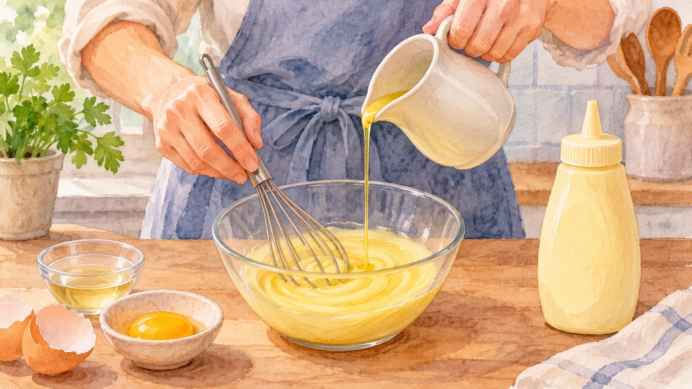
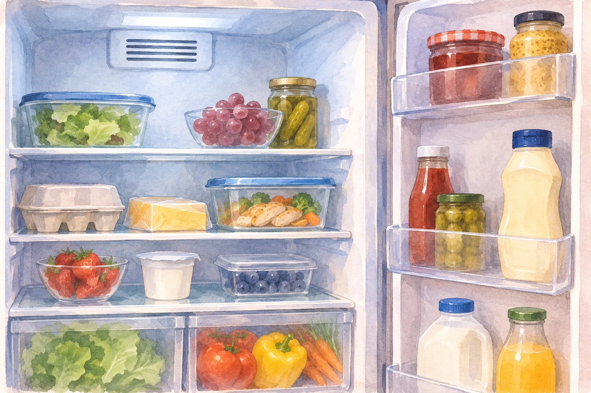

**開けたマヨネーズは冷蔵庫へ。でも、冷やせば冷やすほどよいわけではありません。** キユーピーによると、マヨネーズは0℃以下で油が分離することがあるため、開栓後は冷気の当たらないドアポケットあたりでの保存を勧めています。

AI生成の参考イラスト。乳化の概念画。特定製品の正確な配合や製造工程を再現したものではありません。

## 油と酢が一つになって見える理由

マヨネーズの主な材料である油と酢は、もともと混ざりにくい組み合わせです。それなのにボトルから出すと、白っぽくなめらかな一つのソースに見えます。秘密は、油がとても細かな粒になって全体に散らばっていること。卵黄が油と酢を結びつけ、混ざった状態を支えています。このような状態を「乳化」と呼びます。

キユーピーの製造工程では、卵黄、酢、調味料に植物油を少しずつ加え、すばやく混ぜます。キユーピーは油の粒を細かくすることで、なめらかな舌ざわりを生むと説明しています。つまり、見た目だけの話ではなく、あの口当たりも細かな油の粒に関係しているのです。

## 冷蔵庫の中にも、冷え方の違いがある

開栓後は冷蔵保存が必要ですが、冷蔵庫のどこでも条件は同じではありません。冷気が直接当たる場所では、部分的に強く冷えてしまいます。キユーピーのQ&Aでも、冷蔵庫内で冷気が直接当たるなどして、冷えすぎると分離することがあると説明されています。「冷蔵庫に入れたのに分離した」という疑問には、冷蔵庫内の置き場所が一つの手がかりになります。

AI生成の参考イラスト。保存場所の参考イメージ。冷気の流れや庫内温度を正確に示す図ではありません。

ここでいう分離は、なめらかに混ざっていた状態が崩れて、油が分かれてしまうことです。キユーピーは、一度分離したものは元には戻らないと案内しています。振ったり温めたりすれば元どおりになると決めつけず、状態に不安があるときは製品のメーカーの案内を確認してください。

## 保存は「冷やす」と「凍らせない」の両方

未開栓なら、キユーピーは直射日光を避けた涼しい場所での常温保存を案内しています。開栓後は冷蔵庫に移し、約1カ月を食べ切りの目安にしています。ただし、家庭の冷蔵庫の設定や冷気の通り道はそれぞれ違います。ドアポケットという名前だけで安心せず、冷気が直接当たらない場所を選ぶことが大切です。

「しっかり冷やそう」と冷気の吹き出し口の近くに置きたくなるかもしれませんが、マヨネーズでは低温による分離にも気を配りたいところ。製品ごとの保存表示を確認し、開けたら冷蔵しつつ、冷やしすぎる場所を避ける。それが、なめらかな状態を保つための身近な工夫です。
