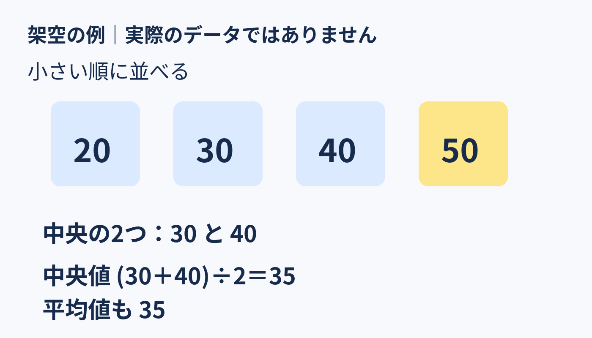

**平均値は全員の値を使って計算し、中央値は並べた順の中央を表すためです。**

「平均が50」と聞くと、真ん中の人も50くらい？　実は、そうとは限りません。

## 5人の架空の数字を並べてみる

**以下はすべて説明用に作った数字で、実際の年収データではありません。** 5人が持つポイントを小さい順に「20、30、30、40、130」とします。

**平均値**は全部を足して人数で割った数。（20＋30＋30＋40＋130）÷5＝**50**です。一方、**中央値**は小さい順に並べた真ん中、3番目の**30**。この例では、大きな130が平均を押し上げています。だから「平均50」は、この5人の誰かが50を持つという意味でも、真ん中の人が50という意味でもありません。

では130を40に替えたら？　並びは「20、30、30、40、40」。平均は32に変わりますが、中央値は30のまま。極端な値を変えると、平均のほうが大きく動きやすいことが分かります。ただし、中央値も人数や真ん中付近の値が変われば動きます。

## 4人なら、真ん中は2つ

人数が偶数なら、中央の2つの値を平均します。たとえば架空の4人が「20、30、40、50」ポイントなら、中央値は（30＋40）÷2＝**35**。平均値も（20＋30＋40＋50）÷4＝**35**です。

つまり、いつも平均と中央値が違うわけでも、中央値が必ず「正解」なわけでもありません。平均は全員の値を使い、中央値は並び順の中央を見る指標。数字を見るときは、**何を知りたいか**に合わせて選び、できれば両方とデータの散らばりも確かめましょう。
