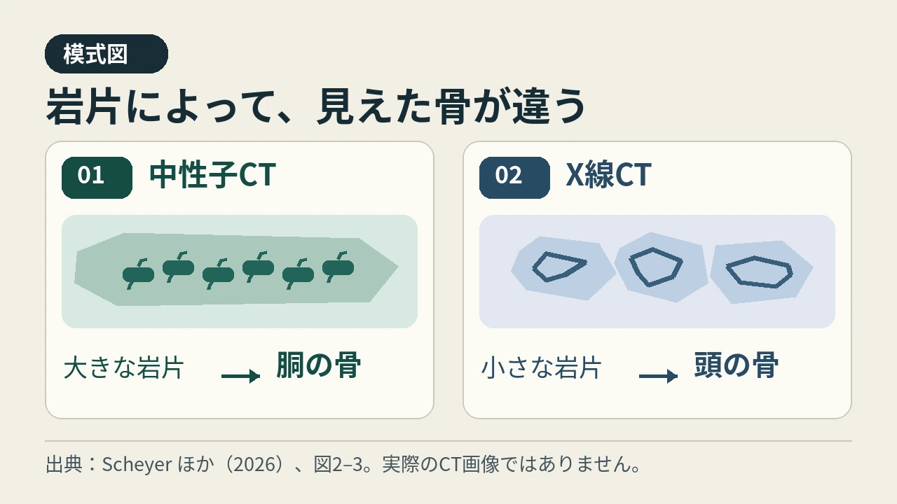

砂岩の表面に、小さな背骨の一部がのぞいていました。スイスのポール・シェラー研究所（PSI）は11月19日、米ワイオミング州で発掘された約1億5600万年前の化石について、絶滅した爬虫類の新属新種と判明したと発表しました。岩の中に残る骨を見分ける鍵は、同じ岩片でも中性子とX線では写り方が違うことでした。

新種の学名は *Meilynodraco amonamarthi*。恐竜ではなく、コリストデラと呼ばれる絶滅爬虫類の仲間です。保存された骨の大きさや比率などから、全長は約45センチと推定されています。小さな頭骨はばらけていましたが、脳を収める骨の部分はほぼ残り、幅は2センチ未満でした。

## 胴と頭骨で、活躍したCTが違った

2022年に発掘された砂岩の大きな岩片を最初にX線CTで撮ると、岩と骨を十分に見分けられませんでした。中性子は水素の影響を受けやすく、この標本では化石の骨と周囲の砂岩の差を見分ける助けになりました。中性子CTで椎骨や肋骨に加え、骨盤など胴の骨の位置も分かりました。

*原著論文の図2–3をもとにした模式図。実際のCT画像ではありません。*

一方、骨の痕跡が見える小さな岩片を後からX線CTで詳しく調べると、頭骨を構成する骨が見つかりました。研究チームは断面画像から骨を見分け、デジタル上で組み合わせました。岩片は撮影前に分割・整形されており、発掘した岩を丸ごと撮るだけで骨格が現れたわけではありません。

## 日本でも、岩の表面だけでは分からなかった化石がある

岡山県の高梁市成羽美術館は2025年、展示していた岩の塊を福井県立大学などの協力でX線CTで調べ、内部に21点の骨化石を確認したと発表しました。こちらは中性子CTを組み合わせたワイオミングの研究とは別で、骨の特徴から魚竜類と判明した事例です。

福井県立恐竜博物館には、化石のCT画像を観察する体験もあります。ワイオミングの標本も、表面の背骨だけを見た段階ではヘビや恐竜の幼体が候補でした。岩の内側に隠れていた骨を見分け、頭骨の形を調べたことで、新しい種類だと分かりました。
