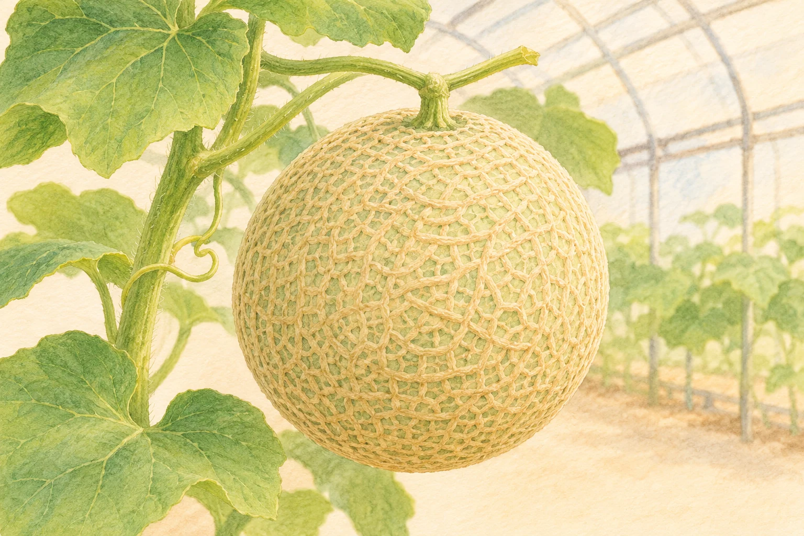
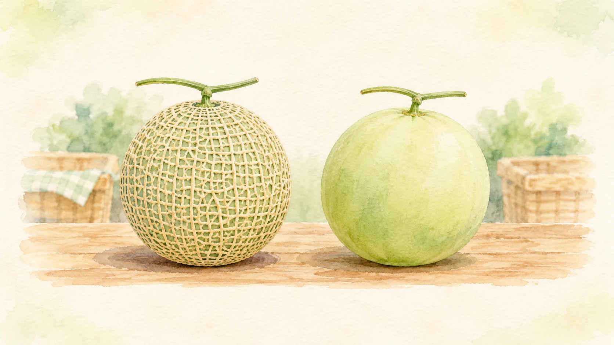

**メロンの網目は、実が大きくなるときにできた皮のひび割れが、コルク質で覆われたものです。** 人が一本ずつ描いたり、彫ったりしているわけではありません。

AI生成の参考イラスト。皮に自然に生じた盛り上がりの参考画で、網をかけたものではありません。形成過程の精密図ではありません。

## ひび割れを覆う層が、網目になる

果肉が成長すると、表面の皮にひびが入ることがあります。その部分がふさがるようにコルク質の層ができ、盛り上がった模様として残ります。[JAグループの説明](https://life.ja-group.jp/food/shun/detail?id=29)では、この模様のあるものを「ネットメロン」と呼んでいます。

[農林水産省の子ども向け解説](https://www.maff.go.jp/j/heya/kodomo_sodan/0107/05.html)は、ひび割れが「かさぶた」のようになったものと説明しています。人間の傷とまったく同じ仕組みではありませんが、ひびができた場所を覆う層だと考えると、模様の成り立ちが分かりやすくなります。

## 自然にできる模様にも、栽培の工夫がある

網目は成長の中で生まれますが、見た目が整うかどうかまで放っておいて決まるわけではありません。[農畜産業振興機構](https://www.alic.go.jp/koho/kikaku03_001543.html)は、きれいな網目を作るために水分管理が重要だと説明しています。

同機構が紹介する温室のアールスメロンでは、水や温度を細かく管理して、外観と品質を整えています。「人工的に線を描く」のと「生育を管理して網目を整える」のは、違う話なのです。

## 網目のないメロンもある

プリンスメロンやハネデューなど、表面に網目がない「ノーネットメロン」もあります。網目はすべてのメロンに共通する特徴ではありません。

AI生成の参考・概念イラスト。品種による外観の違いのみ。甘さや食べ頃は示さない。

あの模様を成長の跡として見ると、食べる前のメロンにも、少し違った見どころが生まれます。ただし、網目だけで甘さや食べ頃までは決められません。模様から分かるのは、実が育つ間に皮のひびがふさがった跡だということです。
