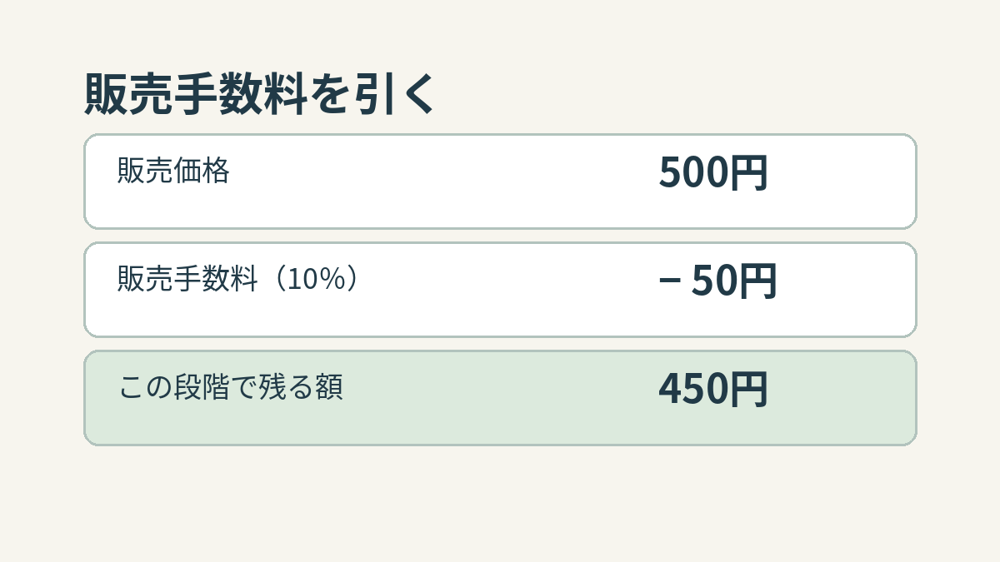
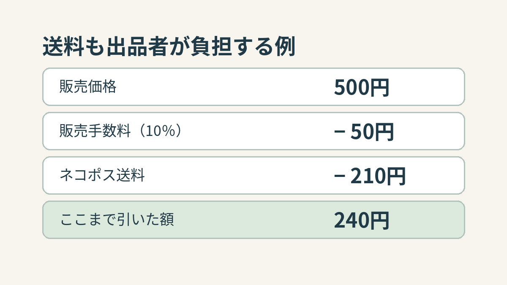

**500円で売れても、販売手数料と送料を出品者が負担するなら、500円がそのまま残るわけではありません。** 個人向けメルカリで、商品が500円で売れて取引が完了し、規定サイズ内の品物を「らくらくメルカリ便」のネコポスで送ると仮定すると、販売手数料50円と送料210円を引いた額は240円です。ただし、これは必要な費用をすべて引いた「最終利益」ではありません。以下は2026年11月12日に確認した公式ヘルプの料金を使った説明例です。

## まず引くのは、販売価格に応じた手数料

メルカリの公式ヘルプによると、個人向けメルカリでは出品時に出品料はかからず、商品が購入され、取引が完了した際に販売価格の10％が販売手数料となります。500円の10％は50円。ここまでなら、500円から50円を引いて450円です。

参考図：500円の10％は50円。取引完了時の販売手数料だけを引いた段階の計算です。

## 送料を出品者が負担するなら、さらに引く

今回の例では、出品者が送料を負担し、荷物が規定サイズ内で「らくらくメルカリ便」のネコポスを利用できたとします。公式ヘルプに示されたネコポスの送料は全国一律210円（税込）。先ほどの450円から210円を引くと240円になります。式にすれば「500円 − 50円 − 210円 ＝ 240円」です。

参考図：500円で売れ、販売手数料10％、出品者負担のネコポス送料210円という条件を置いた計算例。実際の取引記録や平均額ではありません。

ただし、ネコポスには大きさ、厚さ、重さなどの規定があります。サイズが合わず宅急便へ変更された場合は、送料もこの例と異なります。配送方法や送料の負担者が違えば、引き算の結果も変わります。

## 「残る額」と「利益」は別

240円は、ここで挙げた販売手数料と送料だけを引いた額です。封筒や緩衝材などの梱包材に費用をかけた場合や、品物の入手に費用がかかっていた場合、その分はまだ引いていません。売上金を振り込む場合の手数料なども、今回の式には入っていません。したがって「500円で売れたら240円儲かる」とは言えません。

また、この例は個人向けメルカリの通常の販売手数料と、指定した配送方法の公表料金を組み合わせたものです。メルカリShopsやキャンペーンの条件まで同じとみなすことはできません。数字を覚えるより、販売価格から何を引いた段階なのかを分けて見ると、金額を読み違えにくくなります。
