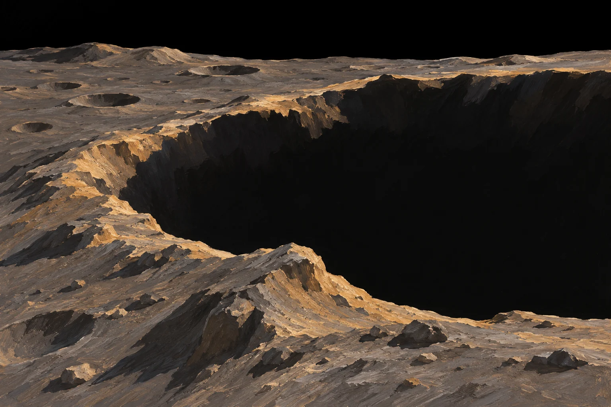
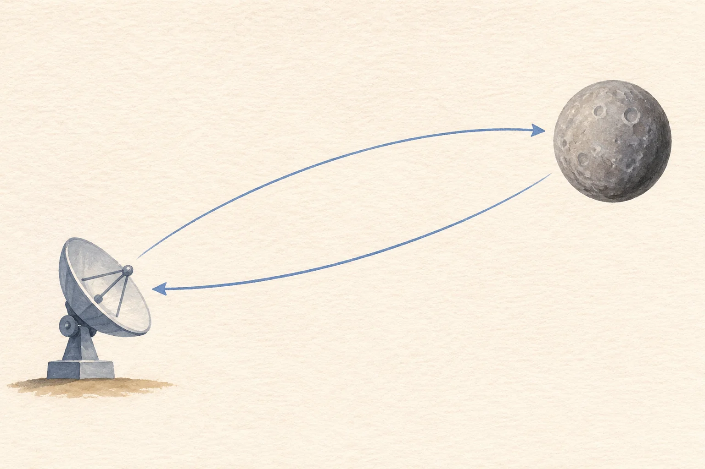

**太陽に最も近い水星にも、水の氷があると考えられています。** ただし、水星が氷に覆われているわけではありません。鍵は、極に近いクレーターの底にある、太陽光が届かない場所です。

極付近のクレーターにできる影の参考イラスト（AI生成）。実地形・観測画像ではなく、氷の分布や露出を示していません。

## 昼は熱いのに、影は冷たい

水星の日が当たる地表は、昼に約430℃に達することがあります。氷とは結びつきにくい暑さです。一方で、水星の自転軸はほとんど傾いていません。極に近い深いクレーターでは、縁が低い角度から差す日光を遮り、底の一部がずっと影のままになります。これを永久影といいます。

NASAの温度地図によると、極に特に近いクレーターの影は、最も暖かいときでも100K、約マイナス173℃を下回る場所があります。そこでなら氷が表面に残れます。ただし、永久影なら必ず表面に氷が見えるわけではありません。少し極から離れたクレーターでは、表面には温かすぎて、氷が暗い物質の下に埋まっていると考えられる場所もあります。

## 氷をどうやって確かめた？

最初の大きな手がかりは、地球からのレーダー観測でした。水星の極付近に、レーダー波を強く返す領域が見つかったのです。ただ、レーダーで明るいことだけでは物質を断定できません。

地上からのレーダー観測の考え方を示す概念イラスト（AI生成）。距離・大きさ・装置は模式的です。反射の強さだけで水と断定せず、影・温度・中性子などの観測と組み合わせます。 矢印は送受信の関係で、電波の実際の軌道ではありません。

次に探査機メッセンジャーがクレーターを撮影し、レーダーで明るい領域が日光の届かない場所と重なることを確かめました。画像は影の位置や一部の堆積物の見え方を示しますが、写真一枚だけで「氷の成分」を分析したわけではありません。南極付近の影の確認には、照明条件が変わる間に繰り返し撮影する方法も使われました。

さらにメッセンジャーの中性子分光計は、北極へ向かうほど中性子の数が変わる様子を測りました。氷がある場合の予測とよく合い、水素が豊富な物質の存在を裏づけます。中性子が示すのは水素の多さで、水分子を直接撮影したわけではありません。レーダー、画像、温度の条件と合わせて、水の氷という説明が強く支持されています。

## 白い氷が一面に広がる？

それも違います。極に近い冷たい場所では表面に露出した氷の証拠がありますが、多くの堆積物では暗い物質に覆われていると考えられます。NASAの中性子データの解釈では、その覆いは平均して約10〜20cmです。水星の極すべてが白い雪景色、というイメージではありません。

強い日差しのすぐそばに、日光が届かない小さな冷たい場所がある。水星の氷は、惑星の温度を一言で語れないことを教えてくれますね。
