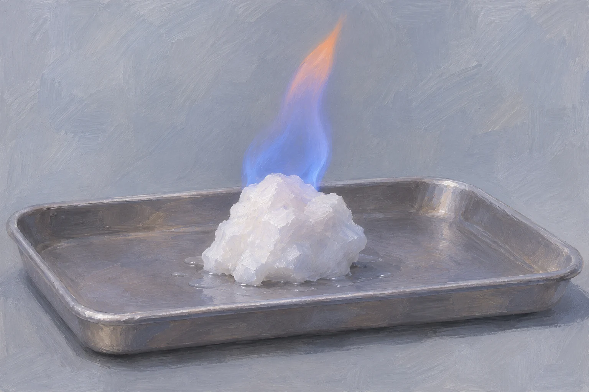
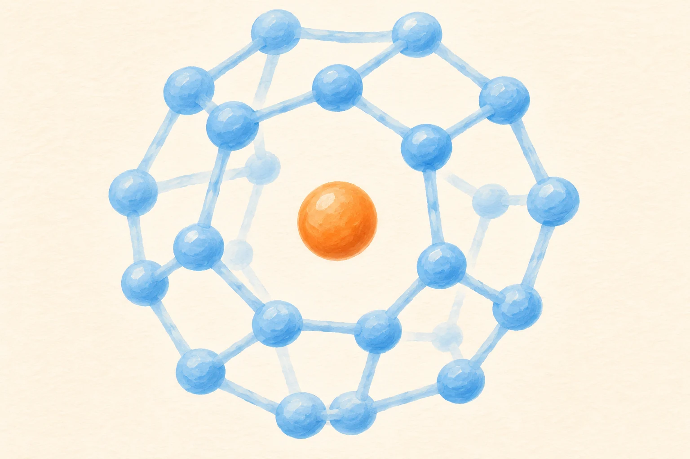

**「燃える氷」と呼ばれるメタンハイドレートは、水分子のかごにメタンが取り込まれた物質です。温度や圧力の条件が変わると水とメタンに分かれ、出てきたメタンに点火すると燃えます。** 氷のような姿から炎が上がるのは、そんな仕組みによるものです。

メタンハイドレートから出たメタンが燃える様子の参考イラスト（AI生成）。実験記録ではありません。普通の氷が燃えるという意味ではありません。

## 水分子のかごに、ガスが収まっている

メタンは天然ガスの主成分でもある気体です。水とメタンが低温・高圧の条件に置かれると、水分子がつくるかご状の構造にメタン分子が入り、氷に似た固体になります。

水分子のかごにメタン分子が収まる関係を単純化した概念イラスト（AI生成）。色・節点の数・結合・大きさを示す正確な原子模型ではありません。

産総研は、この物質が常温・常圧では水とメタンガスに分解すると説明しています。燃焼するのは、そのメタンです。冷凍庫で水を凍らせた普通の氷に火を近づければ、同じことが起きるという話ではありません。

## 深い海の底にあるのはなぜ？

メタンハイドレートが安定して存在するには、温度と圧力の組み合わせが重要です。自然界では海底や海底下の地層、永久凍土地帯の地下などで確認されています。

ただし、「海は深ければ深いほどよい」とも限りません。海底からさらに地中へ進むと、圧力とともに地熱による温度も上がります。冷たさと圧力の条件がそろう範囲に存在できるのです。

また、自然のメタンハイドレートは、きれいな塊で転がっているものばかりではありません。泥の中で塊や層になったものも、砂粒の細かい隙間を埋めるように存在するものもあります。見つかった場所と地層によって、姿も調べ方も変わります。

## 調べるだけでも、圧力を保つ工夫がいる

海底の試料を引き上げると、周囲の圧力が下がります。そのままでは中のメタンハイドレートが分解し、もとの地層の状態を調べにくくなってしまいます。

そこで産総研は、円柱状に採った地質試料に圧力をかけたまま、保存・運搬・分析する技術を開発しました。採った場所の状態を保って運ぶことが、地層を調べる最初の課題になるのです。

## エネルギーとして取り出すには

砂層型の研究では、井戸の周囲の圧力を下げて、水とメタンガスへの分解を促す「減圧法」が使われています。固体をそのまま吸い上げるのではなく、地層の中でガスを取り出しやすくする方法です。

ただ、存在が確認できても、必要な量を安定して生産できるとは限りません。研究側は、生産量の確保やコスト、地層の性質、環境への影響などを検討しています。「どれだけあるか」に加えて、「どのくらい取り出せるか」を確かめる必要があります。

白い塊の写真を見るときも、採られた場所の温度と圧力を一緒に考える必要があります。海の底で保たれていた結晶を地上で調べるには、その環境まで容器の中に持ち運ぶ工夫が要るからです。
