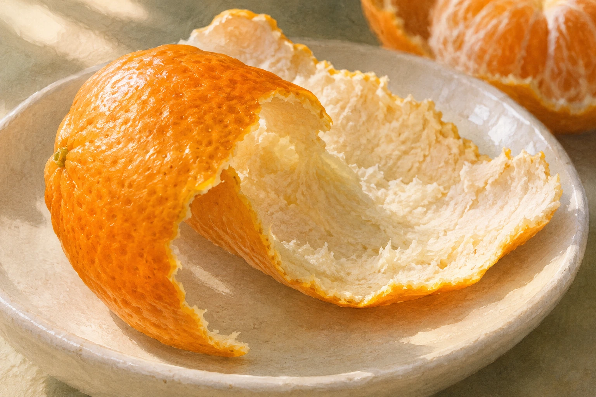

**みかんの皮から出る油には、膨らませた天然ゴムの風船を弱らせ、破裂のきっかけになる成分が含まれています。** 名前はリモネン。みかんをむいたときの、あのさわやかな香りにも関わる物質です。

食べ物の皮と風船。普段は何の関係もなさそうな二つが、材料の性質を通してつながります。ただし、「みかんがあれば、どんな風船でも割れる」というほど単純ではありません。

## 果汁ではなく、皮に含まれる油の話

みかんをむくと、指先にかんきつらしい香りが残ることがあります。浜松科学館の解説によると、皮には「油胞（ゆほう）」という油を含む小さな部分があり、その中にリモネンが含まれています。皮が傷つくと油胞から油が出て、香りが広がります。

ここで注目したいのは、**房から搾る果汁と、皮から出る油を分けて考えること**です。風船との関係を説明する鍵は、酸っぱさではなく、皮の油に含まれるリモネンです。

「みかんの汁」とひとまとめにすると、果汁を思い浮かべてしまいそうです。同じ実から出る液体でも、どこの部分に何が含まれているかで、話が変わるのですね。

## 風船のゴム膜で起きること

天然ゴムの主成分は、ポリイソプレンという長い鎖状の分子です。風船に使うゴム膜では、その鎖同士が部分的につながっています。膨らんだ風船では、その膜が引き伸ばされた状態になっています。

大分大学の技術部報告書では、リモネンがゴム膜に入り込んで膨らむ「膨潤（ぼうじゅん）」が起こり、分子の絡み合いがほどけることで、引っ張りに弱い部分が生じると考察しています。そこへ力が集中し、亀裂につながるという説明です。

「ゴムを溶かす」と短く紹介されることもありますが、風船全体が液体になって消えるわけではありません。**張った膜の一部分が弱くなることが、破裂のきっかけになる**。このほうが、目の前の現象を捉えやすく感じます。

## 一瞬の出来事を、速いカメラで見ると

同じ報告では、天然ゴム製の市販風船にリモネンを接触させ、破裂の様子を高速度カメラで記録しています。撮影した5回とも、リモネンが触れた場所から亀裂が入りました。

肉眼では「急に割れた」としか見えなくても、始まりの場所は観察できます。油に触れた材料が弱くなることと、張った膜が裂けることが、一つの短い出来事の中でつながっているのです。

ただし、これは特定の製品を使った観察です。すべての風船を比較した試験でも、みかんの皮なら毎回同じように割れると示した試験でもありません。

## ゴム風船と、金属色の風船は素材が違う

日本バルーン協会は、ゴム風船の原料を、ゴムの木から得られるラテックスと説明しています。一方、フィルムバルーンには、一般にポリエチレンやナイロンなどのフィルムが使われます。

いわゆるアルミバルーンも、名前だけで素材を判断できません。メーカーによって構成が異なり、気体を逃がしにくくするためにアルミニウムを使うものもあります。ライオンゴムも、ゴム風船とは別のものとしてフィルムバルーンを紹介しています。

どちらも空気やガスを入れて飾る「風船」ですが、材料は同じではありません。天然ゴムで説明された現象を、そのままフィルム製品に当てはめることはできません。反対に、ここから「フィルム製なら何をつけても平気」と考えるのも早計です。

## 「割れないこともある」までが、この雑学

天然ゴム製だからといって、どの製品も同じ条件で作られているわけではありません。日本バルーン協会の説明でも、ゴム膜の厚みや高分子の性質、製造方法には違いがあります。

ただ、その情報だけから「厚いものは割れない」「何回膨らませれば割れる」といった境界を決めることはできません。今回の資料は、製品ごとの割れやすさを予測する一覧表ではないからです。

この話の面白さは、必ず成功する手品として覚えることより、**なじみのある香りの成分が、別の材料の性質に関わる**と分かることにあると思います。みかんの皮にも、風船の薄い膜にも、見た目だけでは気づきにくい性質があります。

普段なら捨ててしまう皮の香りに、食べるときとは違う材料の話が隠れているのですね。
