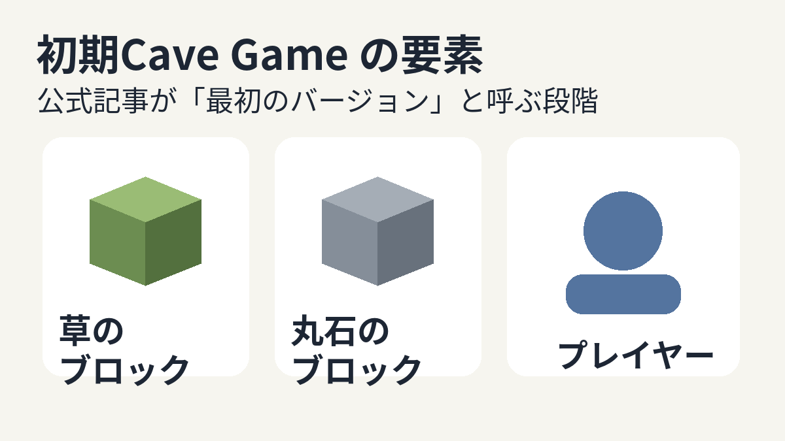
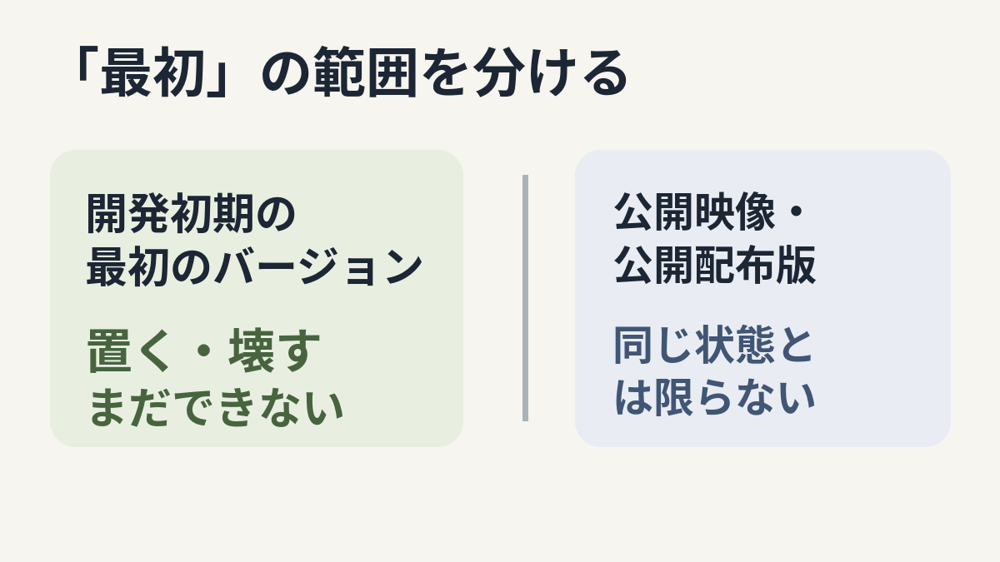

**『Cave Game』の最初のバージョンでは、ブロックを置くことも壊すこともできませんでした。** これはMinecraft公式の開発史記事が伝える、今の遊び方からは意外な出発点です。

## まずは、草と丸石の世界から

2018年のMinecraft公式記事によると、開発者のNotchがMinecraft以前に作っていたRubyDungに、すでに丸石の素材がありました。その後の『Cave Game』最初のバージョンにあったのは、丸石と草のブロック、プレイヤーなど、ごく少数の要素。ブロックを置く・壊すという操作は、まだできなかったと明記されています。

## 「最初」の意味に注意

これは**開発中の最初のバージョン**を説明したものです。最初の公開映像や、一般の人が遊べた最初の公開版の機能を指すとは、公式記事には書かれていません。「2009年のマイクラはずっと壊せなかった」と広げるのは不正確です。別のMinecraft公式記事は、2009年5月16日に石、土、木材のブロックが加わり、名前も『Cave Game』から『Minecraft: Order of the Stone』へ変わったと説明しています。ただし、配置・破壊の操作が具体的にいつ加わったかまでは、今回確認した公式記事だけでは特定できません。

草と丸石とプレイヤーという少ない要素から、ブロックに手を加えられる遊びへ。現在のMinecraftを象徴する操作も、最初から一度に完成していたわけではないのです。
