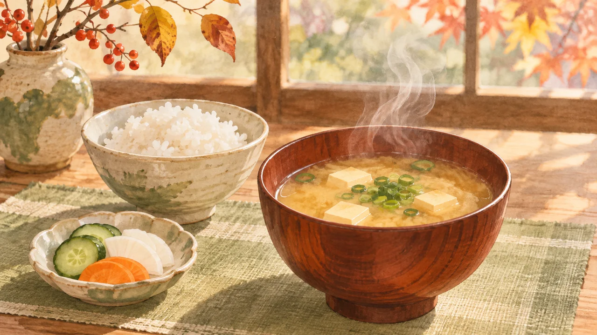
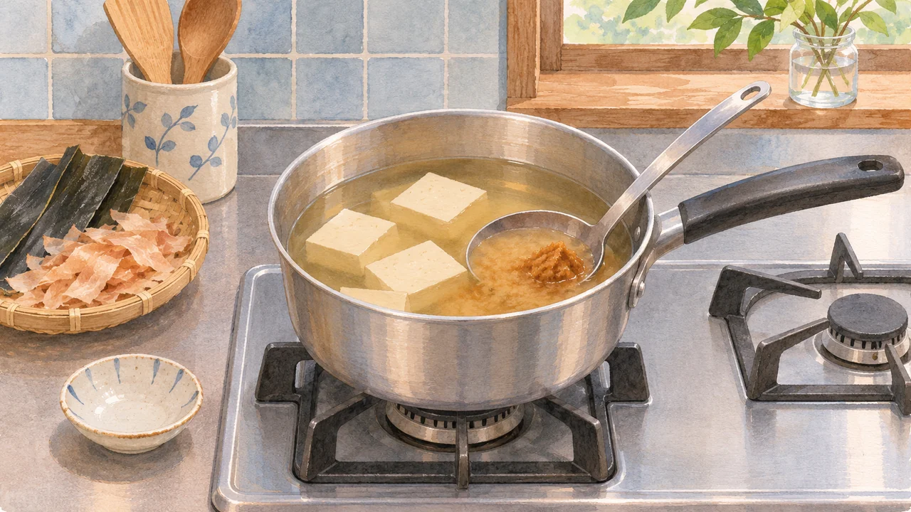

**味噌汁を煮立たせないのは、味噌の香りを残すためです。** 火を使わないのではなく、具材に火を通す時間と、味噌を溶いてからの時間を分けます。味噌を入れたあとは、鍋全体がぐらぐらする手前が火を止める目安です。

朝の食卓を描いたAI生成の参考イラスト。

## 味噌の香りは、塩味とは別もの

米味噌の熟成では、酵母が糖を利用し、アルコールやエステルなどの香り成分が生まれます。どの味噌も同じ匂いではなく、ひかり味噌の香りの分類には、発酵を思わせる甘い香りや、ローストを思わせる香ばしさもあります。

香りの成分には空気中へ移りやすいものがあり、味噌を溶いてから長く煮立てると、できたての香りが弱くなります。塩味が残っていても、一口目の印象まで同じとは限らない。味噌汁を「味」だけでなく、椀を持ち上げたときの香りから考えると、最後に味噌を入れる理由が腑に落ちます。

## 「煮えばな」は、ふつっとしたところ

ひかり味噌の豆腐とわかめのレシピでは、まずだしで具材に火を通し、火を止めます。泡がおさまってから味噌を溶き、温め直すときは、汁がふつっとし始めるところで火を止めます。この煮立つ手前のタイミングが「煮えばな」です。もう十分に熱ければ、香りを出すためにわざわざぐらぐらさせる必要はありません。

味噌を溶く場面を描いたAI生成の参考イラスト。

大根のように火が通るまで時間がかかる具は先に煮て、ねぎや柚子のように香りを楽しみたいものは最後に。全部を一度に鍋へ入れるより、具材には火を通し、香りは食べる直前まで残すと考えると、入れる順番を覚えやすくなります。
