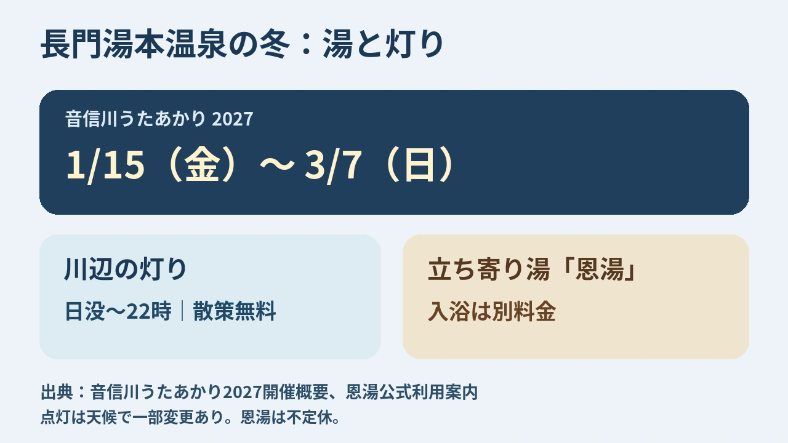

英国のBBC Travelが11月18日に発表した2027年の旅行先20か所に、山口県長門市の長門湯本温泉が選ばれました。地元の観光公式サイトによると、日本からは三重の伊勢志摩と長門湯本の2か所です。長門湯本で日帰りの湯と冬のライトアップを一緒に楽しむなら、**2027年1月15日から3月7日までの日没後**が目安です。

## 岩から湧く湯が見える日帰り浴場

BBC Travelは、地域が主導しておよそ10年かけて温泉街の再生を進めてきたことを紹介し、建て替えられた歴史ある「恩湯」での入浴を見どころに挙げています。

温泉街の中心にあるのが、宿泊しなくても入れる立ち寄り湯「恩湯（おんとう）」です。運営会社によると、浴室では岩盤の割れ目から湯が出る様子が見えます。しかも、岩盤に見える湧き口とは別に、浴槽の底にも泉源があります。お湯の出どころを眺めるだけでなく、湧く場所の上で湯につかれるのがこの浴場の面白さです。

今の建物は2020年に建て替えて開業したもので、600年前の建物が残っているわけではありません。2027年の「開湯600年」は、1427年に大寧寺の僧が湯を見つけたという地元の伝承に基づく節目です。恩湯の入浴は有料で、通常の営業時間は10時から22時。不定休なので、行く日が決まったら[恩湯の公式案内](https://onto.jp/)で営業日と料金を確認してください。

## 灯りがともるのは日没から。散策は無料

「音信川（おとずれがわ）うたあかり」は、長門出身の童謡詩人、金子みすゞの詩を題材にした冬の催しです。期間中は**毎日、日没から22時まで**、恩湯前の雁木広場や竹林の階段などがライトアップされます。散策は無料で、入浴料とは別です。恩湯前の広場では、地元の小学生が萩焼で作ったランプシェードも並ぶ予定です。

*入浴は恩湯、ライトアップは音信川周辺。出典：恩湯の利用案内、音信川うたあかり2027開催概要。*

日帰りなら、暗くなる前にバスで着いて恩湯へ寄り、日没後に広場や竹林へ歩く順だと、湯と灯りをどちらも見られます。22時は消灯時刻で、公共交通の最終便ではありません。例えば、11月26日に確認した[防長交通の時刻表](https://www.bochobus.co.jp/pages/348/)では、長門湯本温泉から天神・博多へ向かう直通便の最終は16時41分です。この時刻表のままなら、直通便で帰る場合は日没後の点灯まで滞在できません。灯りも見るなら、訪問日の乗り継ぎや宿泊を先に検討しておくと安心です。悪天候の日は[イベントの公式案内](https://utaakari.yumotoonsen.com/)も確認してください。

## 美祢線を使うなら、目印は「長門湯本温泉」停留所

JR美祢線は厚狭（あさ）駅と長門市駅の間で列車の運転を見合わせ、代行バスが走っています。温泉街で乗り降りする場所は、2026年10月1日から、旧来の駅前ではなく**長門湯本温泉駐車場にある「長門湯本温泉」停留所**です。ライトアップの会場へは、主催者の案内ではこの駐車場から徒歩約3分。出発前に[JR西日本の運行案内](https://www.westjr.co.jp/suspend/)で訪問日の時刻と乗り場を確かめてください。記事確認時に参照した変更案内の時刻表は2026年12月31日までのため、会期中の時刻とは区別してください。
