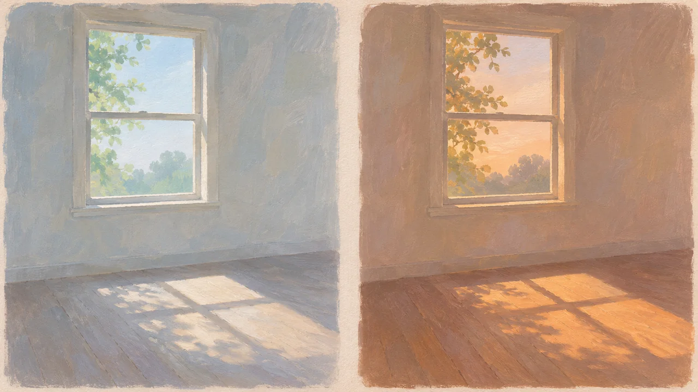

**左右の鼻の穴では、空気の通りやすさが時間とともに変わります。** 通りやすい側が入れ替わる現象は「鼻周期」と呼ばれます。ただし、片方が完全に休むわけでも、決まった時間にきっちり交代するわけでもありません。

## 変わるのは、空気の通りやすさ

鼻の内側では、組織に流れ込む血液の量に応じてふくらみ方が変わり、空気が通る空間の広さに差が生まれます。そのため、左右のどちらが通りやすいかも変わります。

2016年の研究では、成人33人の左右の鼻の空気の流れを24時間記録しました。片側が通りやすい状態が続く時間は、人によっても、同じ人の記録の中でも違いました。「何時間ごとに必ず交代する」と時計のようには決められないのです。

## 両側が一緒に変わることもある

*時間の経過を表しています。鼻の通りやすい側が替わる時刻は決まっていません。*

2024年の別の研究では、鼻の健康に問題のない成人30人を48時間にわたって測定しました。左右が交代するだけでなく、両側の空気の通りやすさが一緒に増えたり減ったりする時間帯もあり、二つのパターンが混ざる人が多く見られました。

ある瞬間を切り取れば、どちらが通りやすいかが見えます。長く測ると、片方ずつ変わる時間もあれば、両方が同じ方向に変わる時間もある。何気なく続けている呼吸の裏で、左右がそんなふうに変化しているのは面白いところです。
