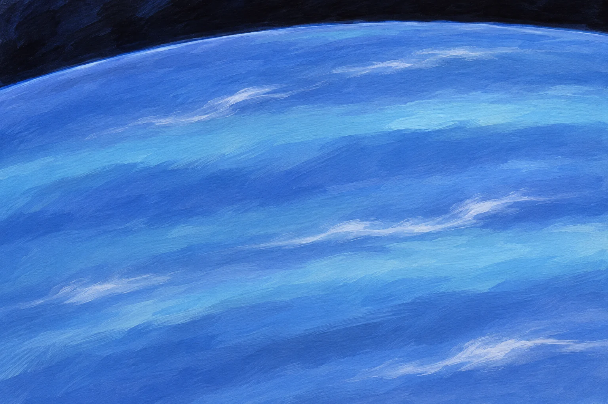
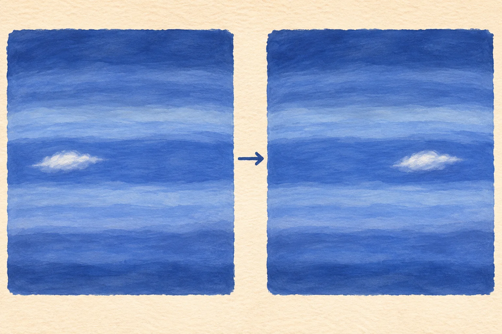

**太陽から遠い海王星では、時速約2000kmに達するほどの強い風が報告されています。** ただし、惑星のどこでも、いつもこの速さで吹いているという意味ではありません。地球からは小さな青い点に見える海王星の「風」を、科学者はどうやって調べたのでしょう。

海王星の大気をイメージした参考イラスト（AI生成）。観測画像や風速図ではなく、雲の位置・色・流れを正確に再現したものではありません。

## 風速計を置いたわけではない

1989年、探査機ボイジャー2号が海王星に接近しました。撮影画像には、明るい雲や大暗斑と呼ばれる暗い模様が写っています。時間をおいて撮った画像で同じ模様の位置を追い、惑星の自転による動きと比べると、大気の流れる速さを推定できます。海王星の雲の中に風速計を入れて測った数字ではないのです。

時間をおいて雲の位置を比べる考え方の模式イラスト（AI生成）。実際の観測画像や風速の計算例ではありません。風速を求めるには惑星の自転による動きなども考慮します。

NASAのボイジャー資料は、大暗斑の近くで風が時速約2000kmに達すると記しています。これは特定の場所で報告された最大級の値です。雲の種類や高さ、観測した緯度によって推定される速さは変わり、惑星全体の普段の風速を示す数字ではありません。

また、模様が移動して見える速さには、惑星そのものの回転も含まれます。観測画像を何枚も比べ、どの緯度でどの特徴を追ったかを確かめる作業が必要です。新聞の見出しに出る一つの数字の裏には、こうした読み取りがあります。

## 暗い嵐も、ずっと残るとは限らない

ボイジャー2号が見た大暗斑は地球ほどの大きさがありました。しかし1994年、ハッブル宇宙望遠鏡の画像では見つからず、別の場所に新しい暗斑が現れました。海王星の空は、一枚の写真から想像するよりずっと変化しています。

暗い模様が見えなくなったことは、風が止んだことを意味しません。雲や嵐の姿は変わっても、大気の流れは続いています。ボイジャー2号の短い接近観測と、その後のハッブルによる観測をつなぐことで、変化が見えてきました。

遠くから撮る画像では、大気の内部まで一度に見通せるわけでもありません。見える雲がどの高さにあり、その下の流れとどう結びつくかにも、調べる余地があります。

## 太陽から遠いのに、なぜ？

海王星は受け取る太陽光が少ないのに、激しい気象を見せます。内部から届く熱と冷たい雲頂との温度差が、大気の不安定さを生む可能性があります。ただ、それだけで風の速さや模様の変化をすべて説明できるわけではありません。NASAも大規模な嵐や雲の変化を、まだ十分には理解できていないとしています。

「時速2000km」という数字の迫力に驚きますが、その数字を得るために遠くの雲を追いかけた観測の工夫も、同じくらい面白いですね。
