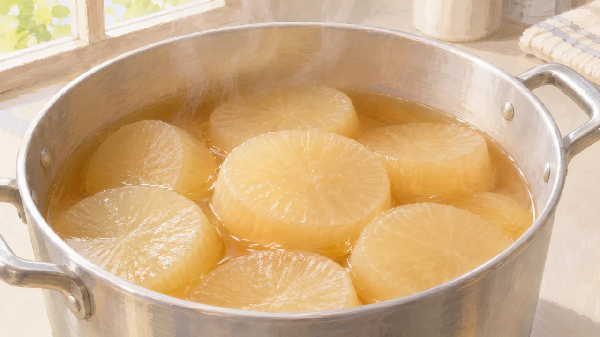
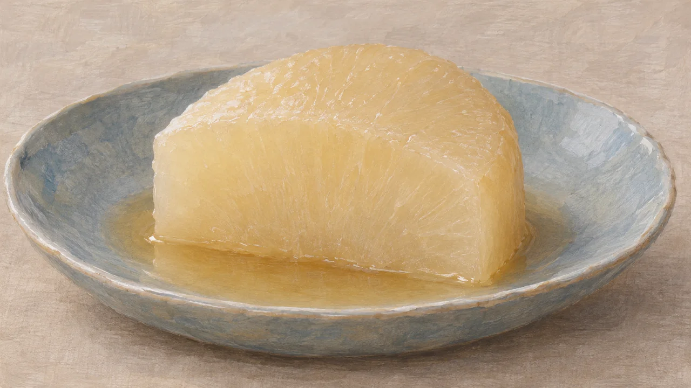

**煮物の塩分は、冷め始めてから初めて中へ移るわけではありません。温かいうちにも移っています。** 「冷めたら味がしみていた」と感じても、温度が下がったことと、その間に時間がたったことは分けて考える必要があります。

## 「冷めたあと」は、時間もたったあと

*大根の煮物の例。実験に用いた試料とは異なります。*

2012年に日本調理科学会誌に掲載された研究では、ジャガイモ、大根、コンニャクを食塩水で加熱し、その後の温度を変えて、食材の外側と内側に移った食塩を測りました。

概して、温度が高い条件のほうが、食材の内側に食塩が多く入っていました。ただし、ジャガイモの外側には単純な温度順にならない結果もあり、ジャガイモを一定温度に保つ場合と冷ます場合の比較には、さらに検証が必要だとしています。

研究者らは、「煮物が冷めると味がしみる」という言い伝えを、冷めるまでに時間がたち、その間に食塩が移ることで説明できると考えました。面白いのは、「冷めたあとに変わっていた」という観察は否定せず、そうなった理由を問い直しているところです。

## 塩分が入ることと、味の全部は別

*大根の断面の色は、塩分の分布を表していません。*

別の大根の研究でも、加熱中に大根の内部の塩分が増えました。一方、同じ煮汁に含まれるコラーゲンや脂質の成分は、塩分とは違う動きをしました。

「味がしみる」と一言でいっても、食塩が中へ移ることと、香りやうま味が変わることは別です。少なくとも塩分に関しては、冷めるのを待って動き出すわけではない。それが、煮物の中身を測って分かったことです。
