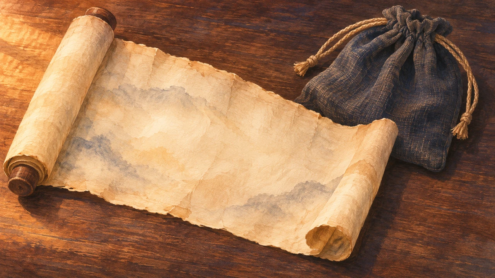
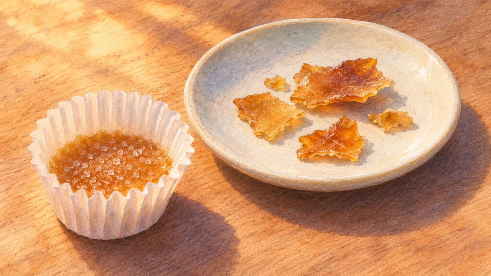

兵糧丸（ひょうろうがん）には、丸く仕上がった現代の試作品があります。面白いのは、同じ久松眞氏の報告に、紙の容器で飴のように固まったものも登場することです。どちらの報告も、江戸時代の伝書『老談集』にある、米より氷砂糖がずっと多い配合をもとにしています。

## 巻物に残った携帯食

三重大学附属図書館の展示目録によると、『老談集』は1845年に馬淵類右衛門がまとめた、馬術と忍術の伝書です。展示されたのは1985年の復刻版。久松氏によると、兵糧丸の材料と分量は分かりますが、具体的な作り方までは書かれていません。

*巻物と携帯袋のイメージ図。『老談集』の実物ではありません。*

## 三重大学の試作では、表面に砂糖の結晶

三重大学の久松眞氏が2015年に公表した試作報告では、もち米とうるち米を合わせた量より、氷砂糖の方がずっと多く使われています。紙などの小さな容器に移したものは、冷めると飴状に。数日後には表面に砂糖の結晶が現れました。鍋底から取った小粒の固形物は、久松氏にはニッキがほのかに香る砂糖菓子のように感じられたそうです。

*三重大学が2015年に公表した試作報告をもとにしたイメージ*

## 同じ研究者の報告には、丸い試作品も

久松氏は2020年の論文で、丸く形を整えながら乾燥させ、球状に仕上げた試作品も報告しています。もち米、うるち米、氷砂糖の分量は、2015年の報告に載っていたものと同じです。カップで固めた例と、手をかけて丸い形にした例。氷砂糖が多いことだけで形が決まるわけではありません。

巻物に材料と分量が残っていても、当時の兵糧丸がどんな形をしていたかまでは分かりません。砂糖の結晶が浮いたり、丸く仕上がったりする現代の試作を見ると、材料表だけからは見えない、作り方の余地が伝わってきます。
