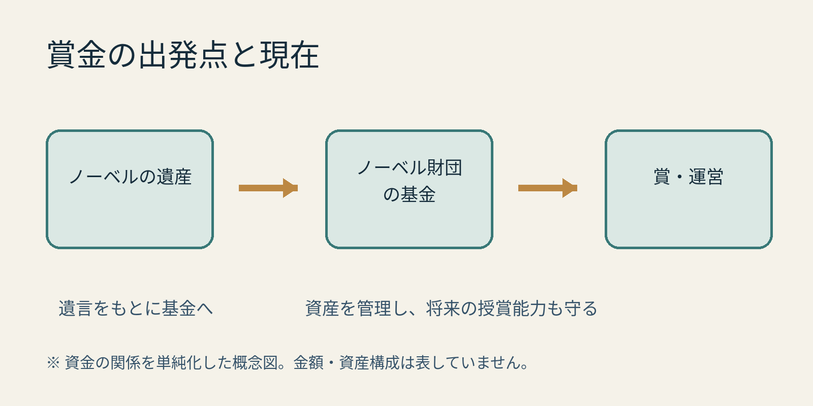

**ノーベル賞の賞金の出発点は、アルフレッド・ノーベルが遺した財産です。** 遺言に従って基金がつくられ、現在もノーベル財団がその資産を管理しながら賞を支えています。ただし「今も銀行預金の利息だけで払っている」という説明では、現在の姿を正確に表せません。[ノーベル賞公式の賞金解説](https://www.nobelprize.org/prizes/about/the-nobel-prize-money/)

資金の関係を単純化した図です。基金の資産が毎年すべて使われることを示すものではありません。

## 遺言には「基金の利子」と書かれていた

ノーベルは1895年の遺言で、財産の大部分を基金にするよう指示しました。そして、その利子を毎年、人類に大きな利益をもたらした人への賞として分配する構想を示しました。

遺言が定めた分野は、物理学、化学、生理学・医学、文学、平和の五つ。「ノーベル本人の財産が賞の土台になった」という話は、この遺言から来ています。[ノーベル財団規則・第1条](https://www.nobelprize.org/about/statutes-of-the-nobel-foundation)

## 現在は「利息だけ」ではない

一方、財団の現在の規則には、**資産の売却による収入も、長期的な授賞能力や資産の実質価値を損なわない範囲で、賞や経費に使える**とあります。資産運用では、長期的な価値を保ち、リスクを分散することも求められます。[ノーベル財団規則・第14条](https://www.nobelprize.org/about/statutes-of-the-nobel-foundation)

つまり、遺言にある「利子」を、そのまま現在の収入源のすべてと考えるのは早計です。その年の賞を支えることと、将来も授賞できる資産を保つこと。その両方が、基金の運営に組み込まれているのです。

AI生成の参考イラスト。学問が続いていく日常のイメージで、実在の受賞者や財団の活動・資金の使途を再現したものではありません。

## 経済学賞は後から設けられた別の賞

ニュースでは六つの分野が並びますが、経済学賞の正式名は「アルフレッド・ノーベル記念スウェーデン国立銀行経済学賞」です。ノーベルの遺言にある五分野には含まれません。

経済学賞は、1968年のスウェーデン国立銀行の寄付によって設けられました。規則にも、銀行がノーベル財団へ拠出する賞金や管理費用について定められています。「六分野すべてが、ノーベルの遺産から同じように支払われる」とも言えないわけです。[経済学賞の規則](https://www.nobelprize.org/about/statutes-for-the-prize-in-economic-sciences)

受賞者の名前に目が向きがちですが、賞を続けるためのお金の仕組みも、ずいぶん長い時間を受け継いでいるのですね。
