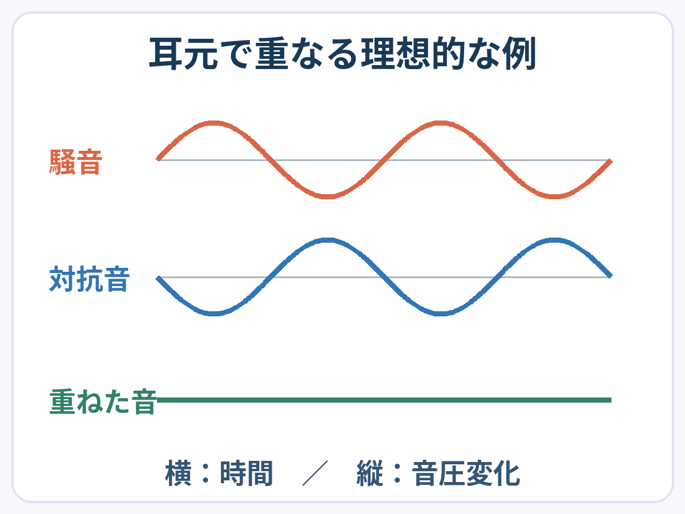

**アクティブノイズキャンセリングは、騒音に対抗する音を作り、耳元で騒音を小さくする仕組みです。** 大きな音楽で騒音をごまかすのでも、周囲の音を部屋ごと消すのでもありません。

音を足すのに、静かになる。少し逆説的ですが、大事なのは音量を増やすことではなく、耳元に届く音の重なり方です。

## マイクが拾った騒音に、逆向きの音を合わせる

[ソニーの開発者による解説](https://www.sony.com/en/SonyInfo/technology/stories/entries/interview_de_asada/)では、マイクで騒音を拾い、鼓膜の近くで騒音と「逆位相」になる音を作ると説明されています。

音は空気の圧力の変化として伝わります。ある音で圧力が高くなるところに、反対に低くなる変化を重ねる。大きさとタイミングがうまく合えば、その場所での圧力変化が小さくなります。

この図だけは仕組みを見るための模式図です。一つの音の成分を理想的に重ねた例で、実際の騒音がすべてゼロになるという意味ではありません。

単にどこかで反対の波を出せばよいわけではなく、**耳元で合うように作る**のがポイントです。ソニーは、処理によって音が遅れてしまうことも開発上の課題として挙げています。「逆向き」という短い言葉の裏に、かなり繊細なタイミングの調整があるのですね。

## イヤーパッドの密着にも、別の役割がある

耳を覆うカップやクッションで外の音を通りにくくする働きは、パッシブ遮音と呼ばれます。電子的に対抗音を作るアクティブ方式とは別で、実際のヘッドホンでは両方が組み合わされています。[Boseの解説](https://www.bose.com/stories/how-do-noise-cancelling-headphones-work)も、この組み合わせと装着具合の重要性を説明しています。

装着を整える場面のイメージです。強く押し付ければ効果が高まるという説明ではありません。

同じ製品でも、耳を覆う部分の収まり方は無関係ではないのです。機能の名前だけでなく、使う人の耳元でどう着けられているかまでが、静かさに関わります。

## 音楽を流していなくても働く？

Boseは、ノイズキャンセリングは音楽再生とは独立して働き、音楽を流していないときにも周囲の音を減らせると説明しています。飛行機内の音やエアコンのうなりなど、続く背景音では違いを感じやすいとされています。利用できるモードや操作は機種ごとに異なります。

だから「静かにするために、音楽を大音量にする」必要はありません。ただし完全な無音を保証する技術でもなく、効果は音や装着状態、機種によって変わります。

周りの世界を消すのではなく、自分の耳元で音を整える。そう捉えると、便利さと限界を一緒に理解しやすくなります。
