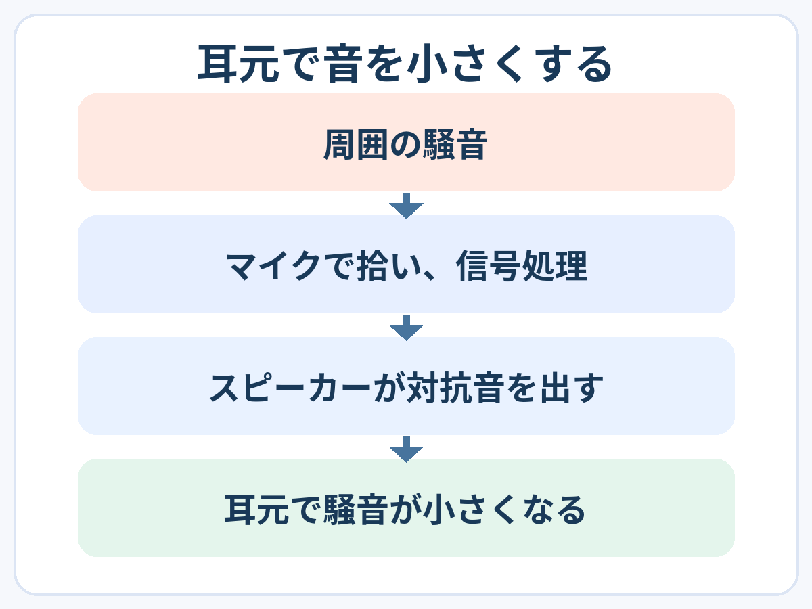

**アクティブノイズキャンセリングは、騒音に対抗する音を作り、耳元の騒音を小さくする仕組みです。** 周囲のすべての音を、部屋ごと消してしまう技術ではありません。「音に音を重ねて静かにする」とは、どういうことでしょう。

## マイクで捉え、対抗する音を出す

[ソニーの開発者による原理の説明](https://www.sony.com/en/SonyInfo/technology/stories/entries/interview_de_asada/)では、マイクで騒音を拾い、**鼓膜の近くで騒音と逆位相になる音**を作るとされています。騒音に対し、圧力の変化が逆向きになるような音です。

図は検出と制御の流れです。騒音そのものも耳元に届き、そこで対抗音と重なります。

## 大事なのは「耳元で」重なること

音は空気の圧力の変化として伝わります。同じ場所で、騒音と逆向きの変化がうまく重なると、その場所の圧力変化は小さくなります。大きさだけでなく、届くタイミングも大切です。

図は同じ地点・同じ時刻で、単一の音の成分が理想的に重なる例です。横は時間、縦は音圧変化。実際の全騒音が完全にゼロになる図ではありません。

単にどこかで反対の波形を出せば、空間中のどこでも静かになるわけではないのです。ソニーの説明でも、対抗音を作る処理の遅れが課題として挙げられています。

## 物理的にふさぐ方法とも組み合わさる

イヤーカップやイヤーピースの密着で音を通りにくくするのは、**パッシブ遮音**。対抗音を作るアクティブ方式とは別の働きです。[Boseの解説](https://www.bose.com/stories/how-do-noise-cancelling-headphones-work)も、両者の組み合わせと装着具合を説明しています。

続く背景音には効果を感じやすい一方、急に変わる音や人の声は減らしにくく、聞こえ残ることがあります。動画の漫画のように声へ反応しない場面があっても、「声まで完全に消える」という実証ではありません。

「逆向きの音」という短い説明の裏に、どの音を、どこで、いつ重ねるかという調整がある。静かにする舞台は、まず耳元なのですね。
