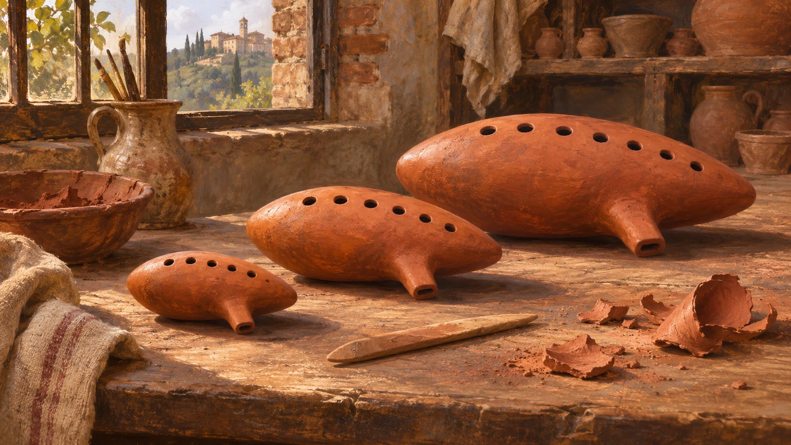
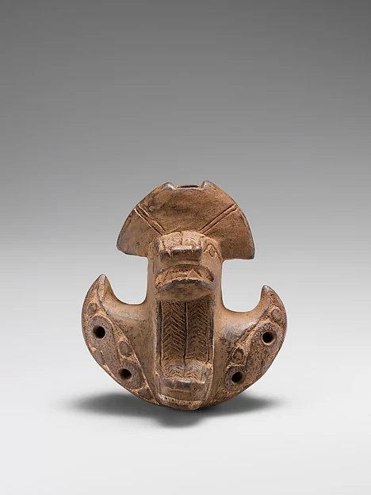

**今につながるイタリアのオカリナを作ったのは、19世紀半ばのジュゼッペ・ドナーティです。** ただし、中が空洞になった器を鳴らす笛まで、彼が初めて作ったわけではありません。イタリアで整えられた楽器の歴史と、世界各地に残る器の形をした笛の歴史を分けると、答えが見えてきます。

## 一つの音色から、合奏できる楽器へ

イタリアのブドリオにある市立博物館は、地元のドナーティが19世紀半ばに作った初期のオカリナを所蔵しています。彼はすでにあった素焼きの丸い笛を改良し、大きさの異なるオカリナを組み合わせることも考えました。一本だけでは出せない音域を、仲間と分担して演奏できるからです。

焼き物の楽器をイメージしたAI生成の参考イラスト。実在の工房や、現存するドナーティの作品を再現したものではありません。

小さな楽器が一つ増えたというより、形や大きさの違う楽器を組み合わせて、できる演奏が変わった。そこまで見ると、ブドリオで生まれたものの何が新しかったのかが、ずっと分かりやすくなります。

## コロンビアにも、ずっと古い「オカリナ」がある

メトロポリタン美術館には、今のコロンビアのシエラネバダ・デ・サンタマルタ地方で、タイロナの人びとが作った陶製の笛があります。作られた時期は1300〜1500年とされ、形は三日月のようです。中央に吹き口があり、指で開閉する穴もあります。美術館はこの品を「オカリナ」と呼び、空洞のある容器笛に分類しています。

実物資料：The Metropolitan Museum of Art「Ocarina」、資料番号1984.507.22、Public Domain。

同じ名前が付いていても、古い笛がイタリアのオカリナの直接の祖先だったと分かるわけではありません。美術館は、この地方の笛にあしらわれた姿が何を意味したのか、形と使い方がどう結び付いていたのかも、はっきりしないと説明しています。

オカリナの「始まり」を聞かれたら、どの形の、どの地域の話かを少しだけ考えてみるとよさそうです。楽器の姿を見比べると、同じ名前の下に別々の工夫が残っていることが分かります。
