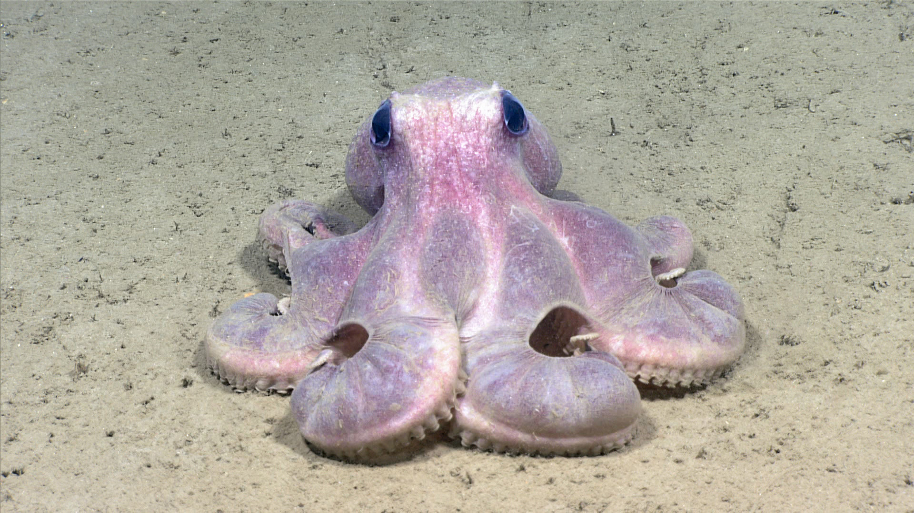
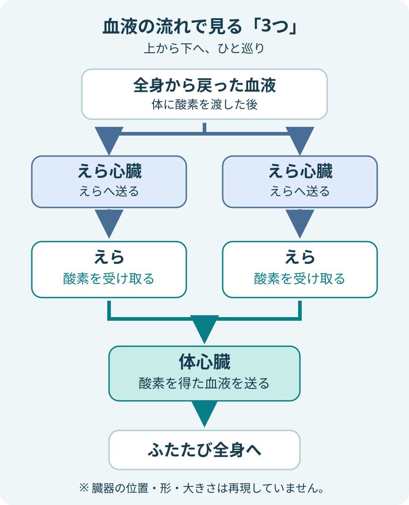
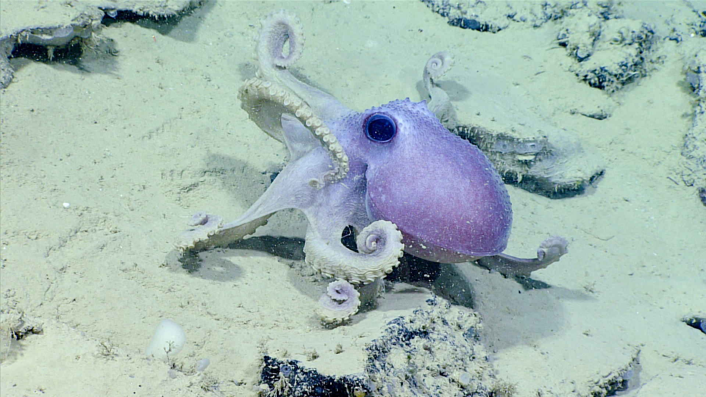

**タコの心臓は3つあります。2つは左右のえらへ血液を送り、残る1つは、えらで酸素を受け取った血液を全身へ送ります。**同じ仕事をする心臓を3個備えたのではなく、血液を送る場所に応じて役割が分かれているのです。

深海のタコ *Graneledone verrucosa*。心臓は外からは見えません。写真：NOAA Office of Ocean Exploration and Research。[掲載元と写真の説明](https://www.noaa.gov/stories/love-is-in-air-and-sea-5-facts-about-affections-of-marine-creatures)（パブリックドメイン）。

## えらへ送る2つ、全身へ送る1つ

えらのそばで働く2つは「えら心臓（鰓心臓）」、全身へ送り出す1つは「体心臓」と呼ばれます。米国海洋大気庁（NOAA）とスミソニアンの解説は、どちらもこの役割分担を示しています。

流れをたどると、全身で酸素を渡した血液は、えら心臓に送り出されて左右のえらを通ります。そこで酸素を受け取った血液を、体心臓が再び体の各部へ押し出します。「3つある」という数字に、血液の通り道を重ねると理解しやすくなります。

NOAAとSmithsonian Oceanの説明をもとにしたオリジナル模式図。上から下へ血液が流れる順を示しています。臓器の実際の位置や大きさを描いた解剖図ではありません。

## 酸素を取り込む場所は、心臓ではなくえら

ここは混同しやすいところです。えら心臓が海水から直接酸素を吸い取るわけではありません。心臓は血液を送るポンプで、血液が水中の酸素を受け取る場所はえらです。

つまり、えら心臓2つと体心臓1つは、互いに代わりをする「本体と予備」という組み合わせではありません。「えらへ通す役」と「全身へ届ける役」。数だけ覚えるより、仕事をセットにすると、この雑学の意外さがはっきりします。

## 青いのは血液。体の色とは別の話

タコの血液には、酸素を運ぶ「ヘモシアニン」という銅を含むたんぱく質があります。スミソニアンは、これが青い血液の色のもとになると説明しています。人間の血液で酸素を運ぶ、鉄を含むヘモグロビンとは違う仕組みです。

写真に写るタコが紫色に見えるからといって、それが血液の色という意味ではありません。外から見える体の色と、体内を流れる血液の色は分けて考えましょう。

海底を進む *Graneledone verrucosa*。2019年の探査で撮影された外観の写真で、心臓や血液を写したものではありません。写真：NOAA Ocean Exploration, Windows to the Deep 2019。[元画像と解説](https://oceanexplorer.noaa.gov/multimedia/okeanos-explorations-ex1907-logs-nov1-media-octopus/)（パブリックドメイン）。

## 数の驚きから、仕組みの面白さへ

心臓が3つと聞くと、ひとつ止まっても平気なのか、と想像してしまいます。でも実際は、それぞれの担当があるとわかったほうが面白く感じます。外からはやわらかな一つの体に見えても、中には血液を送り分ける仕組みがある。次にタコを見るときは、腕だけでなく、見えない体の中の流れも気になりそうです。
