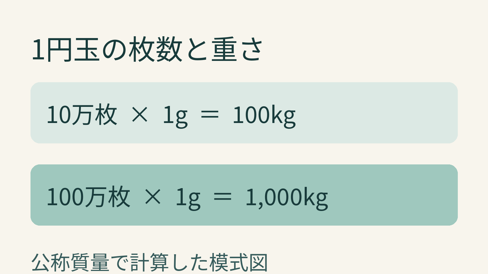
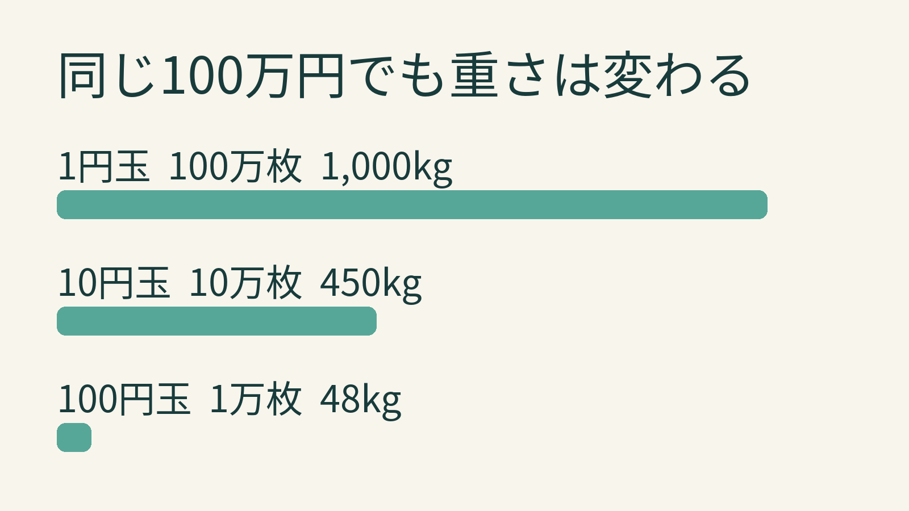

**100万円を全部1円玉にすると、100万枚。1枚1.00gという公称値で計算すれば、合計は1,000,000g、つまり1,000kg＝1トンです。** たった1円分を手に取ったときの軽さと、100万枚を数字で積み上げたときの重さとの落差が面白いところです。

1円玉の公称質量から計算した模式図。容器の重さや実物のばらつきは含みません。

## 100kgから1トンへ、枚数を追ってみる

[財務省の通常貨幣一覧](https://www.mof.go.jp/policy/currency/coin/general_coin/list.htm)では、現在発行されている「一円アルミニウム貨幣」の量目を1.00gとしています。1円玉だけなら、金額の「円」がそのまま枚数です。10万円には10万枚が必要で、10万枚×1g＝10万g＝100kg。そこから金額が10倍の100万円になれば、枚数も重さも10倍です。

ここでいう1トンは硬貨そのものの**計算上の合計質量**。ケースや袋を足した重さでも、どれくらいの場所を占めるかという体積でもありません。

## 同じ100万円でも、額面が変わると？

面白いのは、硬貨の額面が10倍になっても、1枚の重さは10倍にはならないこと。財務省の同じ一覧では、現在発行されている10円青銅貨幣は4.50g、100円白銅貨幣は4.80gです。100万円をそれぞれ一種類だけでそろえた場合を比べてみます。

各額面だけで100万円を作る仮定。棒の長さは計算上の合計質量を表し、実際の硬貨や保管状態は再現していません。

1円玉なら100万枚×1.00g＝1,000kg。10円玉なら10万枚×4.50g＝450kg。100円玉なら1万枚×4.80g＝48kgです。同じ金額でも、1円玉だけの場合と100円玉だけの場合では、計算上の合計質量に大きな差が出ます。決め手は「額面あたり何枚必要か」と「1枚の重さ」の掛け算です。

## 「必ずぴったり1トン」ではない

財務省の[製造貨幣大試験の資料](https://www.mof.go.jp/policy/currency/coin/test/20261009a.html)には、貨幣の量目を試験し、法定量目に対する公差も設けることが記されています。資料は量目を1,000枚ごとにまとめて量る方法を示しています。

だから「100万円分の1円玉は1トン」は、公称値で算出したわかりやすい目安。流通した硬貨を100万枚集めて量った結果まで保証する数字ではありません。小さな硬貨でも、枚数という掛け算が桁違いになると、重さの印象がすっかり変わりますね。
