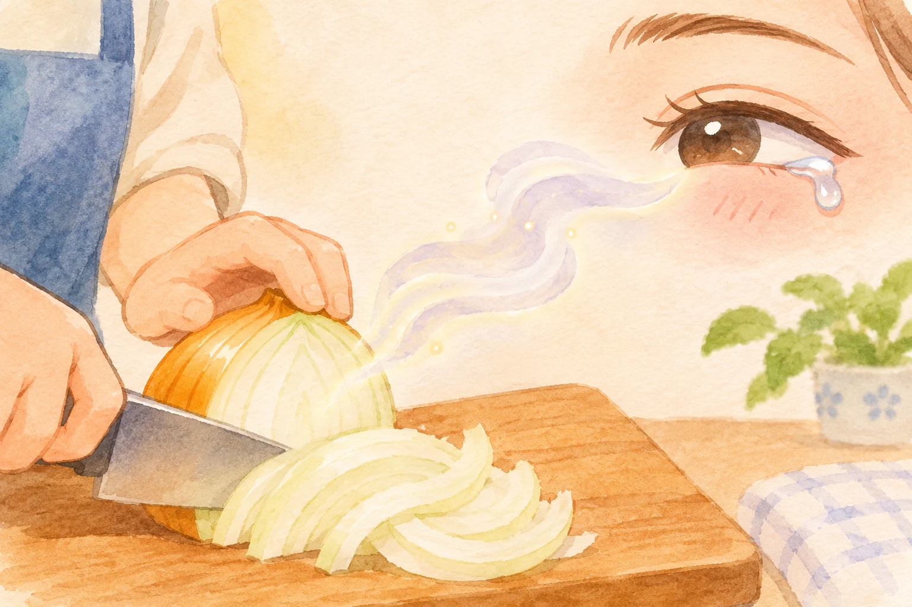
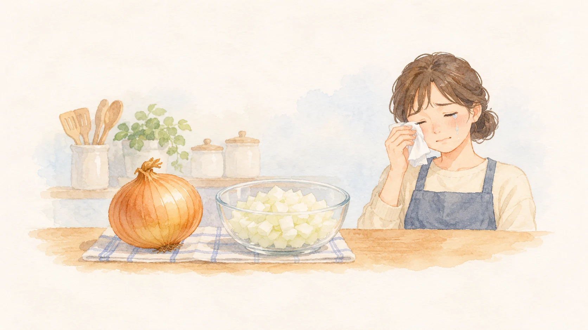

**玉ねぎを切ると涙が出るのは、切って壊れた細胞で催涙成分が生まれ、空気中に広がって目を刺激するからです。** 切る前から「涙の出るガス」が玉ねぎの中に大量に詰まっている、というわけではありません。

AI生成の参考イラスト。玉ねぎを切る手元から目へ届く刺激をイメージした水彩画。実物や実験を記録した画像ではありません。 色付きの線は、目に見えない揮発成分の移動を表す比喩です。

## 切ることで反応が始まる

[ハウス食品グループの研究解説](https://housefoods-group.com/kenkyu/functions/research/oniontears.html)によると、玉ねぎの細胞が壊れると、もともと含まれている成分を材料にして催涙成分がつくられます。できた成分は揮発しやすく、空気中に広がります。それが目の表面に触れると刺激を感じ、涙が出ます。

切った玉ねぎを調理した人が涙を拭う様子を描いたAI生成の参考イラスト。涙の原因物質や酵素を可視化した図ではありません。

## 鍵になる酵素は一つではない

催涙成分ができる過程には、「アリイナーゼ」と「催涙因子合成酵素」という二つの酵素が関わります。[ハウス食品グループの研究](https://housefoods-group.com/kenkyu/functions/research/oniontears.html)では、アリイナーゼに加えて、催涙成分づくりに必要なもう一つの酵素が見つかりました。この成果は2002年に科学誌『Nature』で発表されています。

## 玉ねぎによって、涙の出方は違う

催涙成分の生じ方は、玉ねぎの種類や酵素の働きによって変わります。ハウス食品グループは、酵素の働きを弱くして催涙成分の生成を抑えた玉ねぎも開発しています。すべての玉ねぎが同じように目にしみるわけではないのです。

切る前は細胞の中にあった材料が、包丁で細胞が壊れると酵素の働きで催涙成分に変わります。涙のもとは、切った後に生まれるのです。
