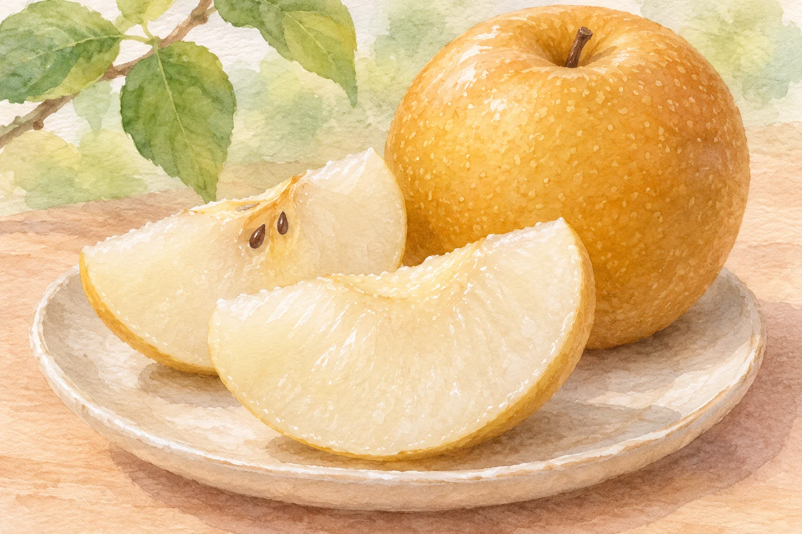
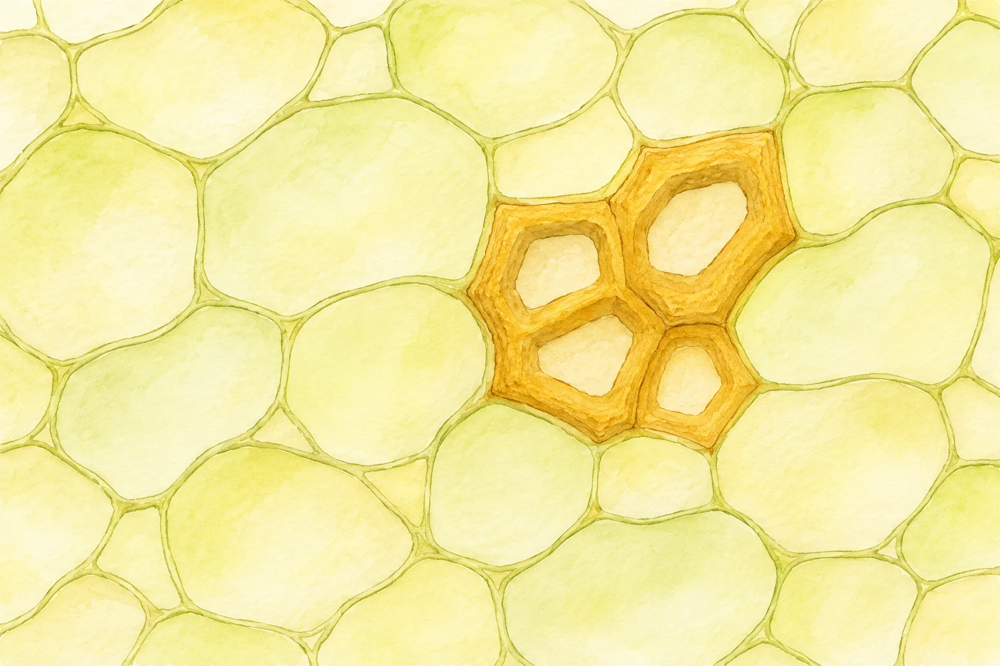

**ナシの果肉にある「石細胞」は、あの独特な食感に関わる植物の細胞です。** 名前に「石」とついていても、果物の中に本物の小石が混ざっているわけではありません。果肉の中の一部の細胞が硬くなったものを、食べたときに感じているのです。

ニホンナシの外観と果肉の参考イラスト（AI生成）。石細胞を拡大・可視化した図ではありません。

## 石細胞とは何？

植物の細胞は、細胞壁という壁で囲まれています。ナシの石細胞では、その壁にリグニンなどの成分がたまり、厚く硬くなります。リグニンは植物の組織を丈夫にする成分の一つ。ただし、石細胞をリグニンだけでできた粒と考えるのも違います。研究報告では、セルロースやヘミセルロースなども細胞壁の成分として挙げられています。

細胞壁が厚くなった石細胞と周囲の細胞を単純化した模式イラスト（AI生成）。色・形・大きさ・個数・分布は実測ではなく、石細胞だけで食感が決まるという意味ではありません。

ナシの果肉をかむと、みずみずしい部分が崩れる感触に、硬めの細胞のざらりとした感触が重なります。石細胞は独特なシャリシャリ感を構成する要素ですが、食感のすべてを一種類の細胞だけで決めることはできません。農研機構の研究者による論文は、ニホンナシの食感には石細胞の密度より果肉の硬さが強く関わるという研究を紹介しています。「シャリシャリの正体は石細胞」と覚えるなら、「石細胞も関係する」と少し幅を持たせるのが正確です。

## どこに多く、ナシなら同じ？

ナシと近縁の果実を調べた研究では、ナシの果芯、果肉、果皮に石細胞とリグニンが確認されました。果実の中で均一に散らばっているわけではなく、部位による違いがあります。また、ニホンナシ5品種の開花後30〜60日の果実を比べた研究や、ニホンナシ「ゴールド二十世紀」とセイヨウナシ「Alexandrine Douillard」を比べた発表では、調べた品種・時期で石細胞の量や大きさに差がありました。すべての品種や収穫時の食感を一律に示す結果ではありませんが、「ナシはどれも同じ食感」とは限らないのです。

研究者らは、石細胞が多いとざらざら感が強くなると考え、肉質をよくする育種を課題にしています。一方で、シャリシャリした歯ざわりをナシらしさとして楽しむ人もいます。石細胞があること自体を、傷みや異物のしるしとして心配する必要はありません。品種ごとの違いを比べるときも、甘さだけでなく、かんだときの細かな感触を意識すると面白そうです。

とはいえ、実際に硬い異物が見つかった場合まで「石細胞だから安全」と決めつけないでください。石細胞は果肉にある細胞の話で、外から混ざった小石などとは別物です。明らかな異物があれば食べるのをやめ、必要に応じて販売店などに確認しましょう。

「石」と聞くと驚きますが、その名の正体はナシ自身の細胞。次に食べるときは、みずみずしさと小さな歯ざわりの組み合わせに注目してみたくなります。
