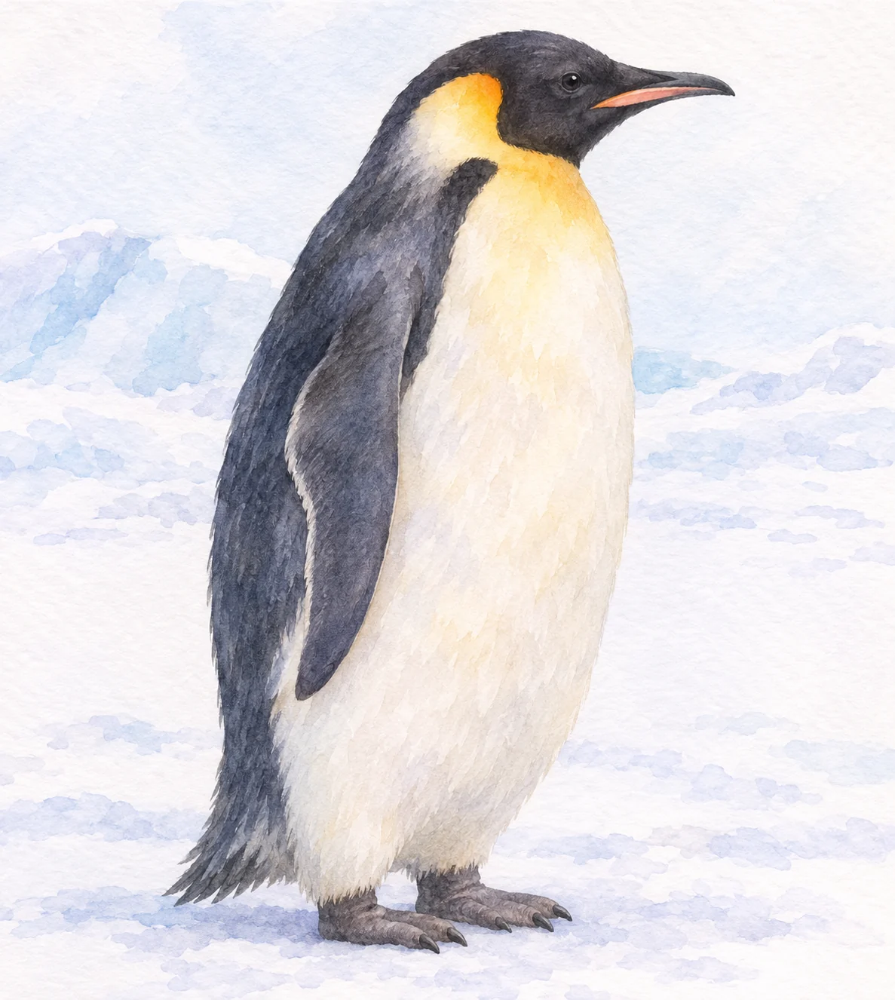
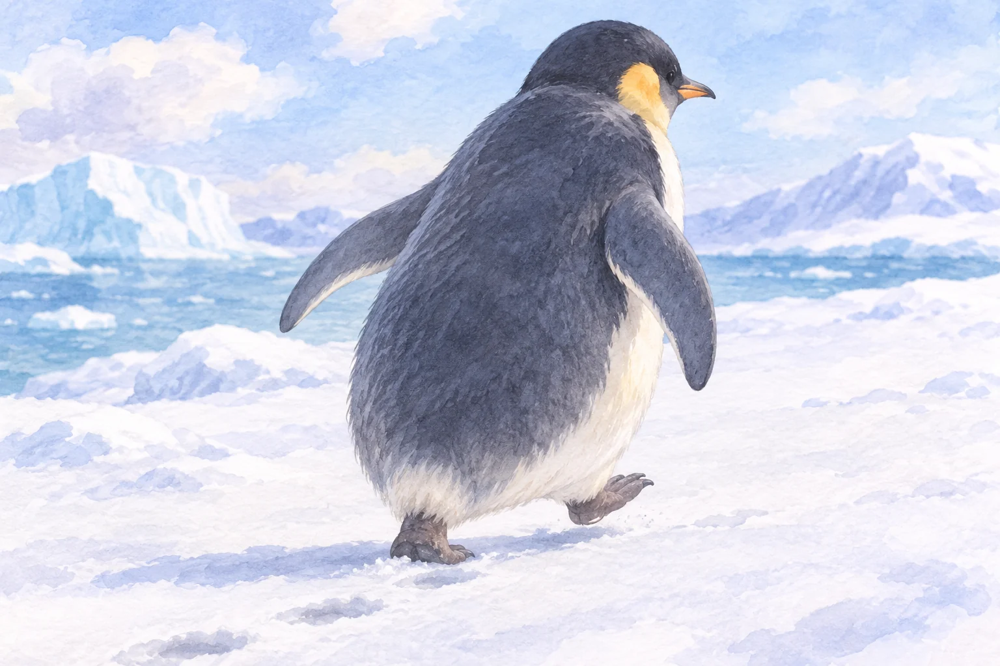

**ペンギンにも膝はあります。** ただし、膝と脚の上の部分は体の羽毛や輪郭に隠れ、外からは見えにくくなっています。

AI生成の参考イラスト。膝を透視・図解した画像ではない。羽毛で見えにくい外観のみ。

## 見えている「脚」は一部分

ペンギンは地上で立っていると、胴からすぐ足が出ているように見えます。しかし、骨格を見ると、ほかの鳥と同じように脚の骨と膝の関節があります。[Penguins Internationalの解説](https://www.penguinsinternational.org/do-penguins-have-knees-and-other-frequently-asked-questions/)は、膝が体の内側に収まる位置にあることを図とともに説明しています。

AI生成の参考・概念イラスト。外観のみ。骨格、膝・足首の正確な位置は示さない。

鳥の脚で「後ろ向きに曲がる膝」に見える部分は、実際には足首にあたります。人間の脚の見た目をそのまま当てはめると、膝の位置を見誤りやすいのです。

## 膝がないわけではない

膝の存在は骨格で確かめられます。つまり「ペンギンには膝がない」のではなく、「立っている姿だけでは膝が分かりにくい」が正確な答えです。

骨格図と立ち姿を見比べると、後ろへ折れて見える部分が足首で、膝は胴の輪郭の内側にあると分かります。
