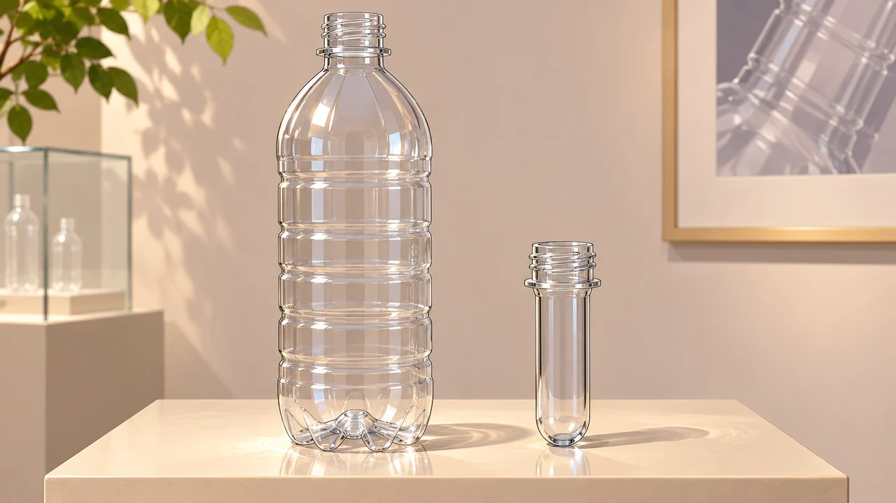
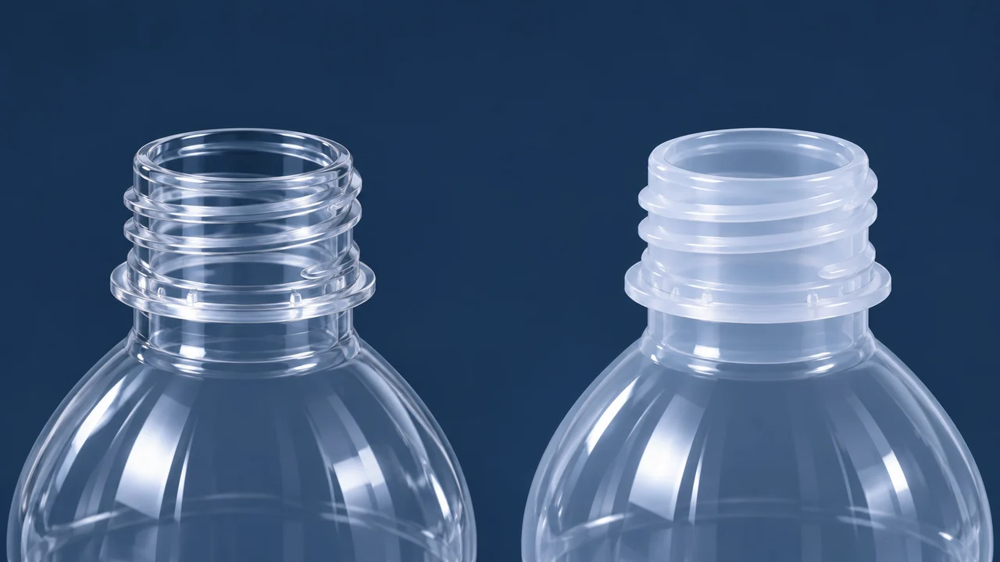

**ペットボトルは、材料が同じPETでも、熱への強さまで同じではありません。熱い中身を詰めるためのボトルには、その条件に合う処理や形の工夫がされています。**

耐熱処理をしていないボトルは、熱で縮んだり変形したりすることがあります。では、温かい飲み物にもペットボトルが使われているのはなぜでしょう。「同じ材料なら同じ性質」と考えると、ちょっと不思議です。

## 材料の名前だけでは決まらない

特定の製品や製造工程を再現した場面ではありません。

サントリーの説明では、ホット用とコールド用のペットボトルは同じ材質ですが、ホット用には熱に耐える構造が採用されています。違う名前のプラスチックへ丸ごと置き換えるのではなく、容器としての作りに違いがあるわけです。

ただし、工場で熱い中身を詰めるための「耐熱用」と、売り場で温かく販売するための「ホット対応」は同じ分類ではありません。工場での詰め方を見てみましょう。

PETボトルリサイクル推進協議会は、PETには温度によって樹脂の性質が変わる境目があり、耐熱処理のないボトルでは収縮が起こると説明しています。この境目が「ガラス転移点」です。透明な見た目が変わらなくても、熱を受けたときのふるまいまで同じとは限りません。

## 飲み物を詰める方法から、必要な容器が変わる

ボトルに求められる性質は、中身だけでなく、工場でどう詰めるかにも左右されます。

たとえば、高温の中身を詰める方式では、ボトルに耐熱性が必要です。一方、中身と容器などを別々に殺菌してから常温で詰める方式もあります。どちらも売り場では同じような飲料に見えても、工場で容器が通ってきた条件は違います。

さらに、高温で詰めて密封した容器では、冷えると内側の圧力も下がります。そのため、熱だけでなく、この圧力の変化も考えて設計されます。丈夫な容器とは、ただ硬い容器ではなく、受け持つ条件に合った容器なのですね。

## 白い口元にも、作るときの工夫がある

この図は、ボトルの耐熱性や使用できる温度を示すものではありません。

東洋製罐の耐熱用ボトルの解説では、口の部分を結晶化させることで、硬さや耐熱性を高めています。こうした処理で口元が白く見えるタイプもあります。白い別素材を取り付けた、と見た目だけで考えてしまいそうですが、全国清涼飲料連合会によると、この白い飲み口も本体と同じPET樹脂です。ここでいう飲み口はボトル本体の口の部分で、キャップやその下のリングとは別です。

ここで紹介したのは、製造時に用途に合わせて設計する話です。「ホット用ならどんな加熱にも耐える」「口元の色で使用条件が全部分かる」という意味ではありません。

透明で軽い、いつもの容器。その形には、中身を詰めるところから届けるところまでの都合が折り込まれています。材料の名前が同じでも、容器としての仕事は一つではない。そう思うと、飲み口や胴の形も少し違って見えてきます。
