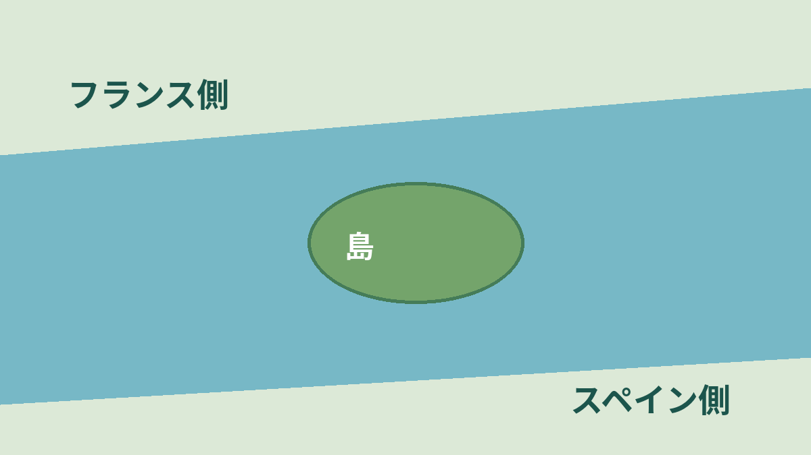
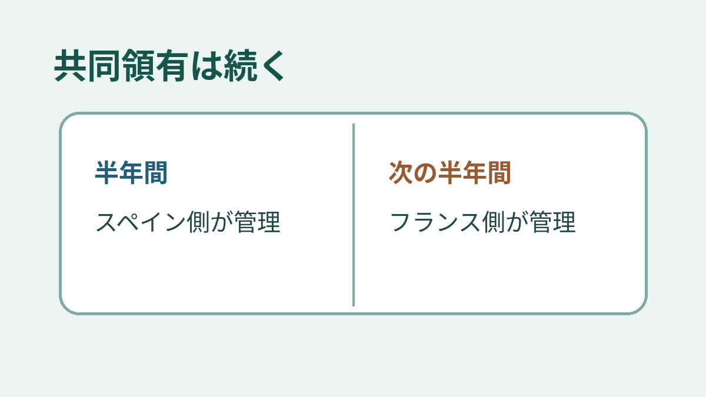

**フェザント島で半年ごとに交代するのは、フランスとスペインの管理担当です。** 島が川を行き来するわけでも、半年ごとに共同領有そのものが終わるわけでもありません。「国が変わる島」と聞くと大ごとに思えますが、まずはこの二つを分けると話が見えてきます。

## 小さな川の島に、二つの国

フェザント島は、フランスのアンダイエとスペインのイルンの間、ビダソア川にある小さな島です。上の図は関係を示す模式図で、正確な地図ではありません。

この島が歴史に残ったのは、外交の舞台になったから。1659年、フランスとスペインが戦争を終わらせたピレネー条約がここで結ばれました。資料は、当時、両国の代表が会うため島の中央に二つの入口を持つ木造の建物が設けられた、と説明しています。相手の領土に踏み込むように見せないための配置でした。両岸の間の小島という立地が、交渉の場所として意味を持ったのです。

## 交代するのは「担当」

仏外務省の資料は、この島をフランスとスペインの「condominium」と説明し、両国が半年ごとに交互に管理すると記しています。アンダイエ市も2024年8月の記事で、島を共同領有としたうえで、**両国の権限行使が6か月ごとに交代する**と説明します。つまり、共同で保有するという説明と、担当する側が替わるという説明は、別の話です。

2026年8月にはアンダイエ市が島での権限引継ぎ式典を伝えています。ただし、ここで説明する制度の中身は、2024年の同市の記事に基づきます。図は交代の仕組みだけの自作模式図で、開始した国や、今日の担当を示すものではありません。

「島の国籍がカレンダーで入れ替わる」と考えるより、**二つの国に結びついた島を、交代で管理している**と捉えるのが、この話の大切なところ。かつて和平交渉の場所だった小島が、今も両国の関係を思わせる場所になっています。
