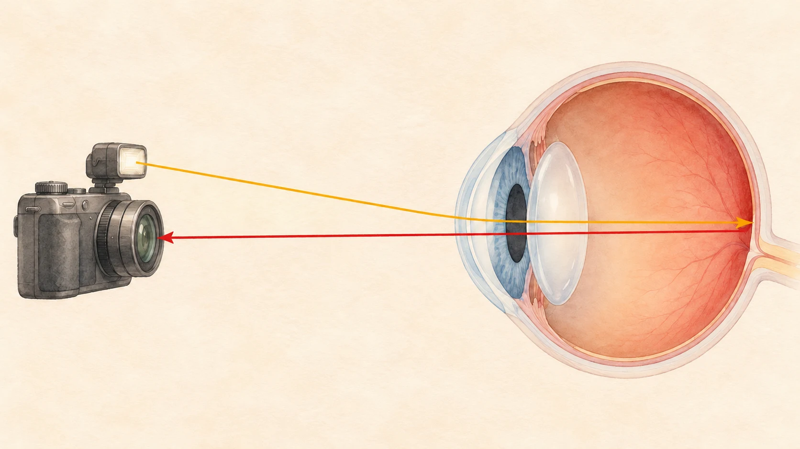

**フラッシュ写真で瞳が赤く写るのは、目に入ったフラッシュの光が目の奥で反射し、カメラに戻ってくるためです。** 黒く見える瞳孔の部分に、奥から戻る赤い光が写り込みます。目そのものが光を出しているわけではありません。

「目が赤くなった」と思いがちですが、撮影した瞬間の光の通り道が写真に現れた現象です。目だけでなく、カメラ側の配置も関係しているところが面白いと思います。

## 光は、瞳孔を通って入ってくる

[ニコンの目の構造の説明](https://www.healthcare.nikon.com/en/eyecare/valuing-eyes/)によると、瞳孔から入った光はレンズを通り、眼球の奥の網膜に像を結びます。瞳孔は黒い模様ではなく、光が入る開口部なのです。

フラッシュを使うと、その光の一部が目の奥から戻り、カメラのレンズへ届きます。[キヤノンのカメラ説明書](https://files.canon-europe.com/files/soft24329/manual/EOSD30_CUG_EN.pdf)も、暗い場所で開いた瞳孔を通った光が網膜で反射し、瞳が赤く写ると説明しています。

橙色は入る光、赤色は戻る光。往復の関係を伝える概念図で、眼球の大きさや屈折の角度を正確に表すものではありません。

## 暗さだけでなく、フラッシュの位置も関係する

暗い場所では瞳孔が開きます。さらに、フラッシュがレンズの見る方向に近い位置にあると、目の奥から戻る光をカメラが捉えやすくなります。説明書でも、フラッシュがレンズの光軸に近い場合に赤目が起こりやすいとされています。

暗い室内での撮影を描いたイメージです。肉眼で相手の目が赤く光って見えるという意味ではありません。

つまり「暗い部屋なら必ず赤目」ではなく、瞳孔と光源・レンズの位置関係が重なって起こるわけです。

## 撮影前に光る「赤目軽減」にも理由がある

キヤノンEOS D30の赤目軽減機能は、撮影前にランプで目を照らして瞳孔を小さくし、赤目を減らす仕組みです。機種によって方式は異なりますが、この例では、撮影後に画像を直すのではなく、**撮る前の目の状態に働きかけています。** 効果には個人差もあり、必ず消せる機能ではありません。

写真の見え方を変えるために、シャッターが切れる前から準備している。この仕組みを知ると、撮影前のひと光りにも意味があると分かります。なお、ここで扱うのは一般的なフラッシュ写真の赤目で、個々の写真から目の健康状態を判断する説明ではありません。
